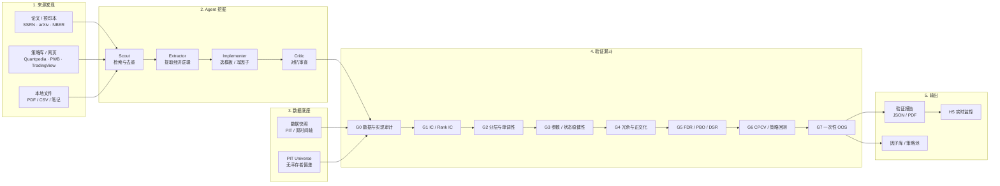
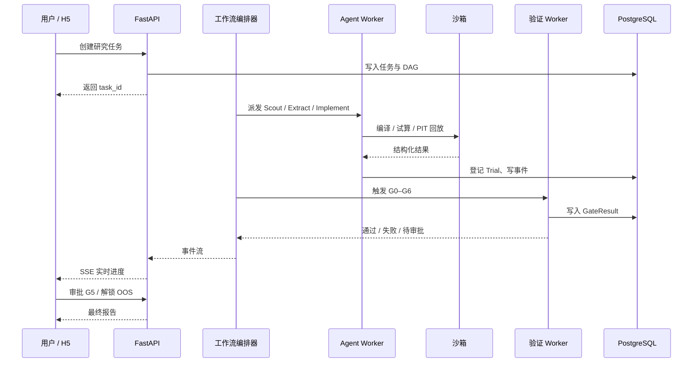
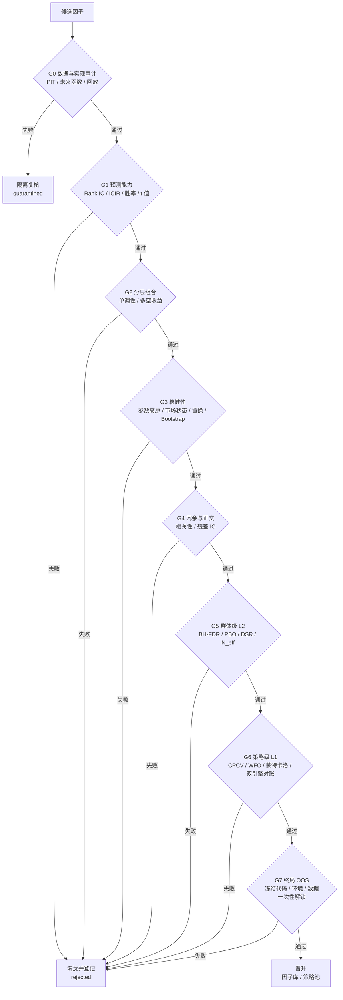
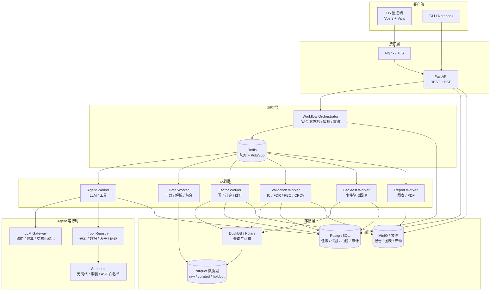
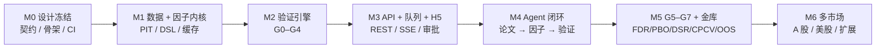

# Quant Research · 因子挖掘与验证 Agent 平台

> **从论文到可信因子：自动挖掘 → 统计验证 → 抗拟合审查 → 可复现报告 → H5 实时监控。**

当前状态：**M0 设计冻结完成，M1 研究内核首个纵向切片已实现**——FactorSpec / ValidationProfile 契约与 JSON Schema、受限 DSL、Polars 因子运行时与内容寻址缓存、双时间轴 Panel、G1 Rank IC 门槛、CLI 与负对照测试。Agent、API、队列与 H5 尚未实现。设计文档见 [`docs/`](docs/README.md)，决策记录见 [`docs/adr/`](docs/adr/README.md)。  
首期市场：**Binance USDT 永续**；后续扩展 A 股/美股。

---

## 1. 这个项目做了什么

传统因子研究有三个难点：

1. **论文到代码难**：SSRN、arXiv、NBER、Quantpedia 等来源每天产生大量想法，但“读懂逻辑 → 写成代码 → 数据对齐 → 回测验证”链路很长。
2. **结果不可信**：未来函数、幸存者偏差、参数过拟合、多重检验、反复偷看样本外，任何一个都能把噪声包装成“圣杯”。
3. **过程是黑箱**：挖了什么、试了多少次、为什么淘汰、结果能否复现，往往没有完整记录。

本项目把这条链路做成一个**有统计纪律的自动化流水线**：

- **Agent 后台挖掘**：自动检索论文/网页/策略库，提取经济逻辑，选择策略模板，生成可执行的因子/策略定义。
- **数据 PIT 审查**：所有计算绑定不可变数据快照，强制使用“当时可获得的数据”，自动检测未来函数与幸存者偏差。
- **G0–G7 验证漏斗**：IC/分层/稳健性/正交化/BH-FDR/PBO/DSR/CPCV/蒙特卡洛，逐层淘汰。
- **一次性 OOS 金库**：最终样本外数据只在所有样本内验证通过后解锁一次，架构级防止数据窥探。
- **H5 实时监控**：任务队列、阶段进度、Agent 过程、验证图表、失败原因、审批操作，手机上随时可看。
- **全链路可复现**：报告绑定 `数据快照 + 代码 commit + 镜像 digest + 参数 + 随机种子`，可回放重算。

一句话：**不是让 Agent 帮你写因子，而是让 Agent 在一条抗过拟合的流水线上产出可信因子。**

### 实现效果

| 维度 | 效果 |
|---|---|
| 研究效率 | 从论文到首个可验证因子，人工数天缩短到 Agent 小时级；先去重再重算，避免无效算力 |
| 结果可信 | 每层门槛有阈值与证据；FDR/PBO/DSR 校正选择偏差；OOS 只解锁一次 |
| 过程透明 | H5 实时查看阶段、Agent 工具调用、失败原因；报告可下钻到指标与图表 |
| 可复现 | 一键重算，报告绑定快照/代码/环境/种子；不一致即阻断晋升 |
| 可扩展 | 新市场、来源、算子、门槛通过注册表接入，不改核心 |
| 成本可控 | 任务级 token/算力/试验预算；超限暂停并通知，而非失控 |

---

## 2. 端到端流程



### Agent 在后台如何运行



---

## 3. 验证漏斗：把“看起来有效”变成“统计上可信”



**核心指标示例**

| 指标 | 示例值 | 门槛 |
|---|---:|---:|
| Rank IC 均值 | 0.031 | ≥ 0.02 / 0.03（按市场） |
| ICIR | 0.62 | ≥ 0.40 / 0.50 |
| IC 胜率 | 57% | ≥ 52% / 55% |
| 分层单调性 | 0.81 | ≥ 0.70 / 0.80 |
| 最大因子相关性 | 0.24 | ≤ 0.30 / 0.50 |
| PBO | 0.18 | ≤ 0.30 |
| DSR p 值 | 0.03 | < 0.05 |

> 阈值按市场/频率配置，并用随机因子、标签置换等负对照校准，不硬编码。

---

## 4. 系统架构



**关键设计**

- **确定性 DAG + Agent 步骤**：阶段流转由状态机控制，Agent 只在步骤内推理，避免自由 Agent 不可审计。
- **Trial Registry**：每次参数变体/失败尝试都登记，作为 FDR/DSR 的真实分母。
- **双回测引擎**：Polars 向量化引擎做快速研究，事件驱动引擎做手续费/滑点/资金费率验证，两者对账。
- **OOS 金库**：独立存储、一次性 token、哈希链账本，按“因子族”消耗，换版本不能绕过。
- **沙箱**：LLM 生成代码无网络、非 root、只读数据、资源限额，先过 AST 白名单和 PIT 回放。

---

## 5. 技术栈

| 层 | 技术 | 用途 |
|---|---|---|
| 语言 | Python 3.13 | 研究、验证、Agent、API |
| Web | FastAPI + Uvicorn + Pydantic v2 | REST、SSE、结构化契约 |
| 数据库 | PostgreSQL 16 + SQLAlchemy 2 + Alembic | 任务、试验、门槛、审计 |
| 队列 | Redis 7 + Celery 5 | 多队列 Worker、重试、租约 |
| 数据计算 | Polars + NumPy + SciPy + statsmodels | 面板计算、统计检验 |
| 查询 | DuckDB + Parquet | 数据湖即席查询 |
| 回测 | 自研向量化引擎 + 事件驱动引擎 | 研究速度 + 交易真实性 |
| Agent | Anthropic Claude（可插拔 LiteLLM） | 论文抽取、代码生成、对抗审查 |
| 沙箱 | Docker（非 root / 无网络 / seccomp） | 执行生成代码 |
| 对象存储 | MinIO（S3 兼容） | 报告、图表、产物 |
| 前端 | Vue 3 + TypeScript + Vite + Vant 4 + Pinia + ECharts | H5 监控端 |
| 实时 | SSE + PostgreSQL 事件回放 | 进度推送、断线续传 |
| 部署 | Docker Compose + Nginx | 单机起步，可扩展 |
| 可观测 | structlog + Prometheus + OpenTelemetry | 日志、指标、链路 |

---

## 6. Agent 角色

| 角色 | 职责 | 产出 |
|---|---|---|
| **Scout** | 从配置的来源检索论文/策略，去重排序 | 候选来源列表 |
| **Extractor** | 解析文档，提取经济逻辑、信号、数据需求、原文引用 | 结构化 Hypothesis |
| **Implementer** | 选择策略模板，填充槽位，生成 FactorSpec | 可编译的因子草案 |
| **Static Auditor** | 未来函数、全样本统计、非法算子、PIT 回放 | 阻断/警告清单 |
| **Validator** | 触发 G0–G6，解读失败原因，提出最小修改 | 验证解读 |
| **Critic** | 独立上下文对抗审查：泄漏、逻辑、实现偏差、过拟合迹象 | 通过/否决 |
| **Reporter** | 汇总报告，突出失败项与证据 | JSON / PDF / H5 报告 |

---

## 7. H5 能看什么

- **看板**：运行中/排队/失败任务、预算消耗、待审批。
- **任务列表**：状态、当前阶段、进度、试验数、告警。
- **任务详情**：阶段 Stepper、实时进度、Agent 过程时间线、日志、Gate 证据、产物下载。
- **因子详情**：IC 时序、累计 IC、分层收益、参数高原、相关性矩阵、PBO/DSR。
- **报告页**：结论、失败门槛、样本量、N_eff、复现清单、PDF 导出。
- **系统页**：队列深度、Worker 心跳、死信重试。
- **审批**：G0/G5/G7 的批准/拒绝，OOS 一次性解锁。

---

## 8. 项目结构

```text
quant-research/
├── docs/                    # 架构设计文档 + ADR
├── examples/                # FactorSpec / ValidationProfile 示例
├── backend/
│   ├── quant/               # ✅ 研究内核：契约、DSL、Panel、因子运行时、G1
│   ├── tests/               # ✅ 单元 / 统计校准测试
│   ├── app/                 # FastAPI、API、编排器（待开发）
│   ├── agents/              # Agent 角色、工具、提示词、契约（待开发）
│   ├── workers/             # Celery Worker（待开发）
│   ├── downloader/          # 现有 Binance 数据下载（待迁移）
│   ├── strategy/            # 现有策略示例（待迁移）
│   └── config/              # 配置
├── webui/                   # H5 前端（待开发）
├── deploy/                  # Docker Compose、Nginx
└── data/                    # 数据湖（gitignored）
```

---

## 9. 设计文档

| 文档 | 内容 |
|---|---|
| [docs/README.md](docs/README.md) | 设计总览、核心决策、对需求的调整建议 |
| [01-system-architecture.md](docs/01-system-architecture.md) | 分层架构、技术选型、运行时拓扑、仓库结构 |
| [02-domain-model.md](docs/02-domain-model.md) | 核心概念、FactorSpec DSL、状态机、数据库模型 |
| [03-agent-system.md](docs/03-agent-system.md) | Agent 角色、工具、结构化契约、沙箱、策略模板库 |
| [04-validation-pipeline.md](docs/04-validation-pipeline.md) | G0–G7 门槛、指标公式、通过标准、报告结构 |
| [05-data-platform.md](docs/05-data-platform.md) | 数据源、PIT、MarketAdapter、快照、缓存、代码迁移 |
| [06-backend-api.md](docs/06-backend-api.md) | REST/SSE API、队列、Worker、错误码、审批与金库 |
| [07-frontend-h5.md](docs/07-frontend-h5.md) | H5 信息架构、页面、图表、SSE 客户端、性能 |
| [08-security-reproducibility.md](docs/08-security-reproducibility.md) | 威胁模型、沙箱、OOS 金库、复现、审计、测试 |
| [09-roadmap.md](docs/09-roadmap.md) | M0–M6 里程碑、验收标准、风险、第一 Sprint |

---

## 10. 路线图



| 阶段 | 目标 | 关键验收 |
|---|---|---|
| M0 | 设计冻结与工程骨架 | 三个契约、CI、ADR |
| M1 | 数据平台与因子内核 | PIT 快照、示例因子、可复现 |
| M2 | G0–G4 验证 | 负对照校准、黄金报告 |
| M3 | API/队列/H5 | 断线续传、审批、移动端可用 |
| M4 | Agent 挖掘闭环 | 本地论文端到端、沙箱与注入测试 |
| M5 | G5–G7 与生产硬化 | PBO/DSR、OOS 金库、安全清单 |
| M6 | 多市场扩展 | A 股 PIT、Barra/FF 正交化 |

---

## 11. 使用方式

### 11.1 当前可用：研究内核 CLI

```bash
# 安装（Python 3.13）
cd backend
python -m venv ../.venv && source ../.venv/bin/activate
pip install -e ".[dev]"

# 本地数据目录结构：<data-dir>/<SYMBOL>/<SYMBOL>-<frequency>.parquet
# 例如 /home/me/binance_data/BTCUSDT/BTCUSDT-30m.parquet

# 计算因子（参数可覆盖；结果写入 Parquet + 同名 JSON 元数据）
python -m quant.cli factor compute \
  --spec ../examples/factor_momentum.yaml \
  --data-dir /path/to/binance_data \
  --output /tmp/factor.parquet

# 运行 G1（Rank IC / ICIR / 胜率 / Newey-West t / 子期胜率）
python -m quant.cli validate \
  --spec ../examples/factor_momentum.yaml \
  --profile ../examples/profile_crypto_perp_30m_v1.yaml \
  --data-dir /path/to/binance_data \
  --gates G1 \
  --output /tmp/g1_report.json

# 导出/校验契约 JSON Schema
python -m quant.cli schema export
```

示例动量因子在本地 30m 样本上 G1 **不通过**（20 bar 收益与未来收益负相关），
这是门槛正常工作的表现：示例用于演示流水线，而不是保证某个因子有效。

### 11.2 规划中的平台使用方式

> 以下为设计目标，尚未实现。

```bash
# 1. 创建研究任务
curl -X POST http://localhost:8000/api/v1/tasks \
  -H "Authorization: Bearer $TOKEN" \
  -H "Content-Type: application/json" \
  -d '{
    "title": "加密市场短期动量因子",
    "goal": "从 arXiv/SSRN 挖掘 1-4 周动量因子并完成 G0-G6 验证",
    "market": "crypto_perp",
    "scope": "cross_sectional",
    "profile_id": "crypto_perp_daily_v1",
    "sources": ["arxiv_qfin", "ssrn", "local_upload"],
    "budget": {"tokens": 2000000, "max_trials": 100}
  }'

# 2. 打开 H5 看板，实时查看阶段、日志、Agent 过程

# 3. 审批 G5，解锁 OOS，获取最终报告
```

**一份报告会回答**：

- 这个因子从哪篇论文/哪个来源来，原文依据是什么？
- 它用了什么数据、什么 universe、什么执行假设？
- 试了多少个参数/变体，失败了多少次，`N_eff` 是多少？
- 通过/失败了哪些门槛，失败原因和证据是什么？
- 结果能否复现，OOS 是否只被消耗了一次？

---

## 12. 设计原则

1. **可复现优先**：任何结论都能回放到数据快照、代码版本和环境。
2. **试验全登记**：没有完整试验记录的 DSR/PBO 都是自欺欺人。
3. **工作流确定、Agent 局部自治**：可审计、可暂停、可审批。
4. **PIT 与 OOS 是架构约束**：由数据层和金库强制，不靠自觉。
5. **先便宜后昂贵**：去重、静态审计、快速 IC 先做。
6. **不信任生成代码**：静态检查 + 沙箱 + 负对照 + 人工复核。
7. **市场无关、配置化**：A 股截面与加密时序共用内核，阈值按 Profile 配置。

---

## 13. 免责声明

本项目用于**量化研究与教育**，不构成投资建议。因子通过统计验证不代表未来收益；实盘前需独立评估交易成本、容量、合规与风险。
