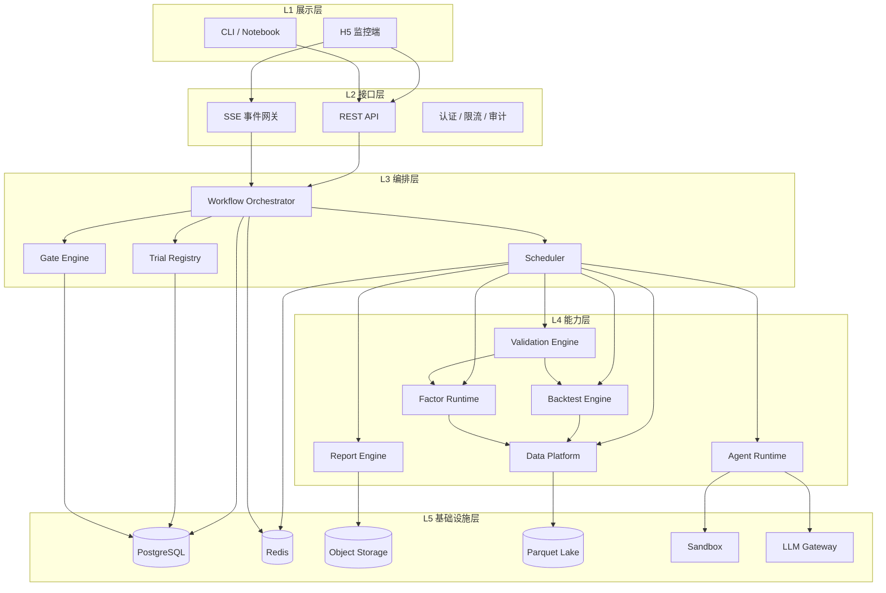
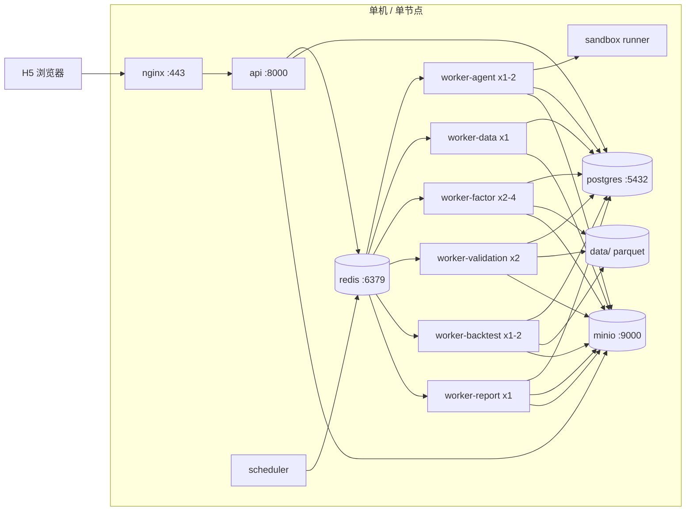
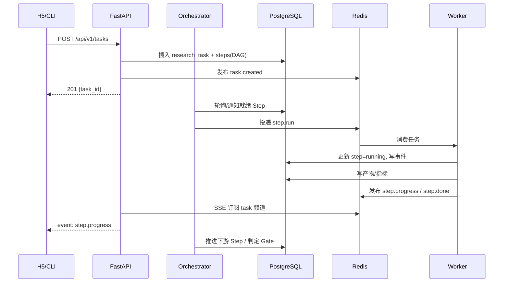

# 01 · 系统架构

> 本文定义平台的逻辑分层、技术选型、运行时拓扑、模块边界与仓库结构。  
> 上游：[README](README.md)　下游：[领域模型](02-domain-model.md)

---

## 1. 架构原则

1. **研究内核与 Web 解耦**：`quant/` 是不依赖 FastAPI/Celery 的纯 Python 库，可单独在 Notebook、CLI、CI 中运行。
2. **状态与计算分离**：PostgreSQL 是任务/试验/门槛状态的唯一事实来源；Redis 只承担队列与事件分发，不保存权威状态。
3. **长任务可恢复**：每个 Step 幂等、可重试、有租约和心跳；Worker 崩溃后由调度器接管。
4. **计算靠近数据**：因子计算在数据湖所在节点/容器执行，避免把大面板通过网络搬运。
5. **重活隔离**：LLM 调用、数据下载、CPU 计算、事件驱动回测使用不同队列与 Worker 池，互不阻塞。
6. **默认不信任生成代码**：任何 Agent 生成的代码必须在沙箱中执行，且先过静态审计。

---

## 2. 逻辑分层



**依赖规则**

- L5 不依赖上层；L4 只依赖 L5 与同层的内核接口；L3 依赖 L4；L2 依赖 L3；L1 只通过 HTTP/SSE 访问。
- `quant/`（L4 内核）禁止 import `app/`、`workers/`、`agents/`，保证可独立测试。
- `agents/` 只通过 Tool Registry 调用能力，不直接访问数据库或数据湖。

---

## 3. 技术选型

| 层 | 技术 | 版本建议 | 选型理由 |
|---|---|---|---|
| 语言 | Python | 3.13（与现有环境一致） | 数据/统计/LLM 生态完整 |
| Web 框架 | FastAPI + Uvicorn | 0.11x / 0.3x | 原生 async、OpenAPI、SSE 友好 |
| 数据校验 | Pydantic v2 | 2.x | 请求/事件/Agent 结构化输出统一 |
| ORM / 迁移 | SQLAlchemy 2 + Alembic | 2.0 / 1.13 | 事务、JSONB、可迁移 |
| 元数据库 | PostgreSQL | 16+ | 事务 + JSONB + 窗口函数 + 可靠队列兜底 |
| 队列 | Celery + Redis | 5.x / 7.x | 成熟、路由灵活、可观测 |
| 事件分发 | Redis Pub/Sub + PostgreSQL 事件表 | — | 实时推送 + 断线回放 |
| 数据计算 | Polars | 1.x | 列式、惰性、快、与现有代码一致 |
| 查询 | DuckDB | 1.x | 直接查 Parquet，适合研究型 SQL |
| 统计 | NumPy / SciPy / statsmodels / scikit-learn | — | IC、回归、BH、聚类、bootstrap |
| 回测 | 自研向量化面板引擎 + 事件驱动适配器 | — | 研究速度与交易真实性兼顾 |
| Agent | Anthropic Claude SDK（可插拔 LiteLLM） | — | 工具调用/结构化输出成熟 |
| 沙箱 | Docker + 非 root + 无网络 + seccomp | — | 成本低、隔离够用；后续可换 gVisor/Firecracker |
| 对象存储 | MinIO（本地可退化为文件系统） | — | S3 兼容、内容寻址 |
| 前端 | Vue 3 + TypeScript + Vite + Vant 4 + Pinia + ECharts | — | H5 组件成熟、包体小 |
| 反向代理 | Nginx | — | TLS、静态资源、SSE 透传 |
| 可观测 | structlog + Prometheus + OpenTelemetry | — | 结构化日志、指标、链路 |
| 测试 | pytest + Hypothesis + golden datasets | — | 统计代码需要性质测试与基准数据 |

> **不引入**：Airflow/Dagster 作为主编排（研究任务不是数据资产编排）；Kafka（MVP 规模不需要）；Kubernetes（单机 Compose 足够）。

---

## 4. 运行时拓扑



**进程职责**

| 进程 | 职责 | 扩展方式 |
|---|---|---|
| `api` | REST、SSE、鉴权、创建/查询任务 | 无状态，可水平扩展 |
| `scheduler` | 扫描就绪 Step、派发、超时回收、定时任务 | 单实例（带选举锁） |
| `worker-agent` | LLM 调用、工具编排、沙箱执行 | 按 LLM 配额扩展 |
| `worker-data` | 下载、解析、聚合、数据质量检查 | 按 IO 扩展 |
| `worker-factor` | 因子计算、缓存写入 | 按 CPU/内存扩展 |
| `worker-validation` | IC、分层、稳健性、CPCV、PBO、DSR | 按 CPU 扩展 |
| `worker-backtest` | 事件驱动回测、交易成本模拟 | 按 CPU 扩展 |
| `worker-report` | 图表、PDF/JSON 报告 | 可合并到 validation |
| `sandbox runner` | 隔离执行生成代码 | 独立容器/节点 |

---

## 5. 核心执行流

### 5.1 创建研究任务



### 5.2 Step 生命周期

```
pending → ready → running → (passed | failed | skipped)
                    │
                    ├→ waiting_human → (passed | failed)
                    ├→ retrying → running
                    └→ cancelled
```

- **幂等**：Step 的缓存键 = `hash(step_type, 输入产物哈希, 代码哈希, 配置哈希, snapshot_id)`；命中则直接复用产物。
- **租约**：Worker 领取 Step 时写入 `lease_until` 与 `heartbeat_at`；超过租约由 scheduler 回收。
- **重试**：按错误类型区分——`Transient`（网络/限流）自动重试；`Validation`（代码错误）回到实现阶段；`Fatal`（数据缺失/权限）终止并告警。
- **人工门槛**：Step 进入 `waiting_human` 后，H5 显示审批卡片；审批动作写入 `gate_results` 和 `audit_log`。

### 5.3 事件流

- 所有状态变化先写 PostgreSQL（`task_events`，自增 `seq`），再发布 Redis Pub/Sub。
- SSE 连接可用 `Last-Event-ID` 从 DB 回放遗漏事件，保证断线不丢进度。
- 事件是**追加式**的，不更新、不删除；任务详情由事件与当前状态表共同投影。

---

## 6. 模块职责

| 模块 | 目录 | 职责 | 不做什么 |
|---|---|---|---|
| `quant.data` | `backend/quant/data/` | 数据源适配、PIT 连接、快照、数据质量 | 不生成因子 |
| `quant.factors` | `backend/quant/factors/` | DSL 解析、算子、计算、缓存、因子库 | 不做组合与回测 |
| `quant.validation` | `backend/quant/validation/` | G0–G7 门槛、指标、统计检验 | 不写报告 UI |
| `quant.backtest` | `backend/quant/backtest/` | 向量化与事件驱动引擎、成本模型 | 不访问数据库 |
| `quant.portfolio` | `backend/quant/portfolio/` | 组合构建、权重、换手控制 | 不做执行 |
| `quant.report` | `backend/quant/report/` | 报告数据组装、图表规格、导出 | 不做前端渲染 |
| `app` | `backend/app/` | FastAPI、鉴权、API Schema、SSE | 不包含研究逻辑 |
| `orchestrator` | `backend/app/orchestrator/` | DAG、调度、重试、状态机 | 不执行计算 |
| `agents` | `backend/agents/` | 角色、提示词、工具、结构化契约 | 不直接访问 DB/文件 |
| `workers` | `backend/workers/` | Celery 任务入口、队列路由 | 不实现业务算法 |
| `webui` | `webui/` | H5 页面与状态管理 | 不做本地重计算 |

---

## 7. 推荐仓库结构

```text
quant-research/
├── docs/                          # 本设计文档
├── backend/
│   ├── pyproject.toml             # 包管理、工具配置
│   ├── alembic.ini
│   ├── migrations/                # 数据库迁移
│   ├── app/
│   │   ├── main.py                # FastAPI 入口
│   │   ├── api/v1/                # 路由：tasks, factors, runs, gates...
│   │   ├── core/                  # 配置、鉴权、日志、异常、SSE
│   │   ├── models/                # SQLAlchemy 模型
│   │   ├── schemas/               # Pydantic 请求/响应/事件
│   │   ├── services/              # 应用服务（用例编排）
│   │   └── orchestrator/          # DAG、调度器、Gate Engine
│   ├── quant/                     # 纯研究内核（可独立发布）
│   │   ├── data/
│   │   │   ├── adapters/          # binance, cn_equity, ...
│   │   │   ├── catalog.py
│   │   │   ├── pit.py
│   │   │   ├── snapshot.py
│   │   │   └── quality.py
│   │   ├── factors/
│   │   │   ├── dsl/               # 语法、AST、校验
│   │   │   ├── operators/         # ts_*, cs_*, math_*
│   │   │   ├── runtime.py
│   │   │   ├── registry.py
│   │   │   └── library/           # 内置/经典因子
│   │   ├── validation/
│   │   │   ├── profile.py
│   │   │   ├── gates/             # g0..g7
│   │   │   ├── metrics.py
│   │   │   ├── multiple_testing.py
│   │   │   ├── cpcv.py
│   │   │   └── significance.py
│   │   ├── backtest/
│   │   │   ├── vectorized.py
│   │   │   ├── event_driven.py
│   │   │   ├── costs.py
│   │   │   └── reconcile.py
│   │   ├── portfolio/
│   │   └── report/
│   ├── agents/
│   │   ├── roles/                 # scout, extractor, implementer...
│   │   ├── tools/                 # Tool Registry 实现
│   │   ├── prompts/               # 版本化提示词
│   │   ├── contracts.py           # 结构化输出 Schema
│   │   ├── gateway.py             # LLM 路由/预算/缓存
│   │   └── runtime.py             # Step 内 Agent 循环
│   ├── workers/
│   │   ├── celery_app.py
│   │   ├── agent_tasks.py
│   │   ├── data_tasks.py
│   │   ├── factor_tasks.py
│   │   ├── validation_tasks.py
│   │   └── backtest_tasks.py
│   ├── config/                    # 现有配置迁移
│   ├── strategy/                  # 现有策略模板（后续迁移到 quant/）
│   ├── downloader/                # 现有下载器（后续迁移到 quant/data/sources）
│   └── tests/
│       ├── unit/
│       ├── integration/
│       ├── statistical/           # 用已知分布校准检验
│       └── golden/                # 固定快照的回归测试
├── webui/
│   ├── src/
│   │   ├── api/                   # REST + SSE 客户端
│   │   ├── stores/                # Pinia
│   │   ├── views/                 # 页面
│   │   ├── components/            # 通用组件 + 图表
│   │   ├── router/
│   │   └── styles/
│   └── package.json
├── deploy/
│   ├── docker-compose.yml
│   ├── nginx.conf
│   └── Dockerfile.*
├── data/                          # gitignored
│   ├── raw/
│   ├── curated/
│   ├── snapshots/
│   ├── artifacts/
│   └── holdout/
└── .env.example
```

**迁移原则**：现有 `downloader/`、`strategy/` 不立即删除；先包一层适配器接入 `quant/data` 与 `quant/backtest`，跑通回归测试后再移动，避免一次性大重构。

---

## 8. 关键边界与接口

### 8.1 研究内核接口（稳定契约）

```python
# quant/data/adapters/base.py
class MarketAdapter(Protocol):
    market: str
    def calendar(self) -> TradingCalendar: ...
    def universe(self, as_of: datetime) -> list[str]: ...
    def load_panel(
        self,
        fields: list[FieldRef],
        start: datetime,
        end: datetime,
        universe: list[str] | None = None,
        as_of: datetime | None = None,
    ) -> Panel: ...

# quant/factors/runtime.py
class FactorRuntime(Protocol):
    def compile(self, spec: FactorSpec) -> CompiledFactor: ...
    def compute(self, factor: CompiledFactor, snapshot: DataSnapshot) -> FactorValues: ...

# quant/validation/gates/base.py
class Gate(Protocol):
    id: str
    def evaluate(self, ctx: ValidationContext) -> GateResult: ...
```

### 8.2 编排器接口

```python
class Orchestrator(Protocol):
    def submit(self, task: ResearchTask) -> TaskId: ...
    def pause(self, task_id: TaskId) -> None: ...
    def resume(self, task_id: TaskId) -> None: ...
    def cancel(self, task_id: TaskId) -> None: ...
    def approve(self, gate_id: str, decision: Decision) -> None: ...
```

MVP 用 PostgreSQL DAG + Celery 实现；未来可替换为 Temporal，不改上层 API。

### 8.3 数据与产物

- **大对象不进 PostgreSQL**：因子值、面板、图表、日志文件写入对象存储/文件系统，DB 只存 `artifact_id + uri + sha256 + size + media_type`。
- **内容寻址**：`artifacts/{sha256[:2]}/{sha256}`，天然去重。
- **快照清单**：`snapshots/{snapshot_id}/manifest.json` 记录所有输入文件哈希与版本。

---

## 9. 队列与 Worker

| 队列 | 负载 | 并发建议 | 超时 | 重试 |
|---|---|---|---|---|
| `q.agent` | LLM 调用、工具编排 | 1–2（受配额限制） | 30 min/step | 指数退避，最多 3 次 |
| `q.data` | 下载、解析、聚合 | 1–2 | 2 h | 网络错误重试，404 不重试 |
| `q.factor` | 因子计算 | CPU 核数/2 | 30 min | 计算错误不重试 |
| `q.validation` | 统计检验、CPCV | CPU 核数/2 | 2 h | 仅基础设施错误重试 |
| `q.backtest` | 事件驱动回测 | 1–2 | 2 h | 同上 |
| `q.report` | 图表/PDF | 1 | 15 min | 可重试 |

**隔离策略**

- 每个 Worker 池独立进程/容器，设置内存上限。
- 大面板计算限制 `POLARS_MAX_THREADS`，避免单任务吃满机器。
- LLM 队列与计算队列分离，避免长回测阻塞 Agent 监控。

---

## 10. 一致性与幂等

| 场景 | 方案 |
|---|---|
| Step 重复投递 | DB 行锁 + `status` 条件更新；缓存键命中直接返回 |
| Worker 崩溃 | 租约超时回收；Step 重新入队；产物按哈希幂等覆盖 |
| 事件丢失 | DB `task_events` 为事实来源；SSE 断线回放 |
| 重复创建任务 | 客户端 `Idempotency-Key`，服务端 24h 去重 |
| 并发写同一因子 | 因子版本不可变；新计算生成新 `trial` |
| OOS 重复解锁 | 金库账本唯一约束 + 一次性令牌；第二次请求直接拒绝 |

**事务边界**：状态变更与事件写入在同一 PostgreSQL 事务中完成（outbox 表），再由 dispatcher 投递 Redis，避免“状态已改但事件没发”。

---

## 11. 扩展点

| 扩展点 | 接口 | 新增方式 |
|---|---|---|
| 市场 | `MarketAdapter` | 实现适配器 + 注册 + 配置 ValidationProfile |
| 数据源 | `SourceConnector` | 实现 `discover/fetch/parse`，注册到 catalog |
| 因子算子 | `Operator` | 声明签名、因果性、实现 Polars 表达式 |
| 验证门槛 | `Gate` | 实现 `evaluate`，在 Profile 中启用与排序 |
| Agent 角色 | `AgentRole` | 定义输入输出契约 + 提示词 + 允许工具 |
| Agent 工具 | `Tool` | JSON Schema + 权限 + 幂等 + 实现 |
| 报告模块 | `ReportSection` | 返回结构化数据 + 图表规格 |
| 通知渠道 | `Notifier` | Web Push / 邮件 / Webhook |

所有扩展通过注册表（Registry）发现，不在核心代码中写死 `if market == ...`。

---

## 12. 非功能需求

| 维度 | 目标 |
|---|---|
| 任务吞吐 | 单机每日 ≥ 500 个因子试验（不含 CPCV） |
| 因子计算 | 100 标的 × 5 年日频，单因子 < 10 s（Polars，缓存命中 < 100 ms） |
| API 延迟 | 列表/详情 P95 < 300 ms；SSE 首字节 < 1 s |
| 进度延迟 | 事件产生到 H5 可见 < 2 s |
| 可用性 | 单机；Worker 崩溃不影响已提交任务，重启后自动恢复 |
| 成本 | 每个研究任务设置 token/算力预算；超预算暂停并告警 |
| 数据规模 | 首期 < 200 GB；Parquet + DuckDB 足够 |
| 安全 | 生成代码无网络、无宿主机写权限；外部内容按不可信数据处理 |

---

## 13. 部署

### 13.1 Docker Compose 服务

| 服务 | 镜像/构建 | 端口 | 数据卷 |
|---|---|---|---|
| `nginx` | nginx:alpine | 443/80 | `deploy/nginx.conf`, `webui/dist` |
| `api` | backend Dockerfile | 8000 | `data/`, `.env` |
| `scheduler` | 同 api | — | `data/` |
| `worker-agent` | 同 api | — | `data/`, docker.sock（仅沙箱管理） |
| `worker-data` | 同 api | — | `data/` |
| `worker-factor` | 同 api | — | `data/` |
| `worker-validation` | 同 api | — | `data/` |
| `worker-backtest` | 同 api | — | `data/` |
| `postgres` | postgres:16 | 5432 | `pgdata/` |
| `redis` | redis:7-alpine | 6379 | `redisdata/` |
| `minio` | minio/minio | 9000/9001 | `miniodata/` |

### 13.2 环境分层

- **dev**：本地 Compose，MinIO 可退化为 `data/artifacts/`，LLM 可用 mock。
- **paper**：真实数据 + 真实 LLM，OOS 金库启用。
- **prod**：仅在公司内网/VPN，TLS，备份，监控告警。

### 13.3 配置

- 配置全部来自环境变量 + `config/*.yaml`；密钥只来自 `.env`/Secret Manager。
- `config/validation_profiles/*.yaml` 版本化，报告记录 `profile_hash`。
- `config/sources/*.yaml` 定义来源、限速、许可策略。

---

## 14. ADR 摘要

| ADR | 决策 | 状态 |
|---|---|---|
| ADR-001 | 确定性 DAG + Agent 步骤，而非自由 Agent | 接受 |
| ADR-002 | 受限 DSL 优先，Python 兜底 | 接受 |
| ADR-003 | 双回测引擎 + 对账 | 接受 |
| ADR-004 | Trial Registry 为统计校正的分母 | 接受 |
| ADR-005 | SSE 而非 WebSocket | 接受 |
| ADR-006 | PostgreSQL + Parquet/DuckDB 混合存储 | 接受 |
| ADR-007 | Celery MVP，Orchestrator 接口可替换 | 接受 |
| ADR-008 | OOS 金库一次性解锁 + 不可变账本 | 接受 |
| ADR-009 | 沙箱无网络、AST 白名单 | 接受 |
| ADR-010 | 市场无关 + ValidationProfile 配置 | 接受 |

后续每个 ADR 可在 `docs/adr/` 下展开为单独文件（背景、选项、后果）。
