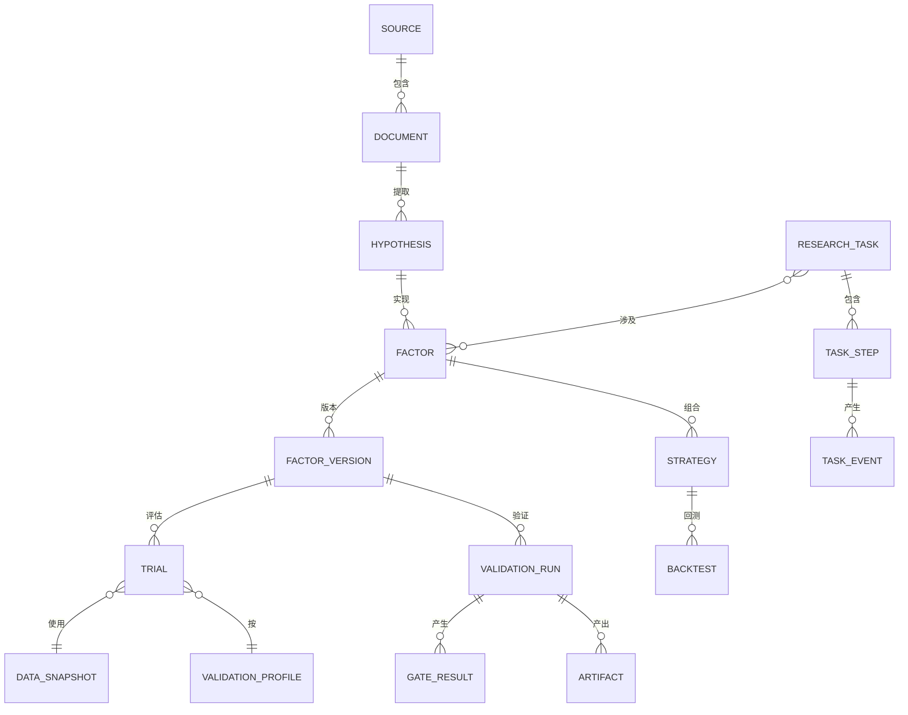
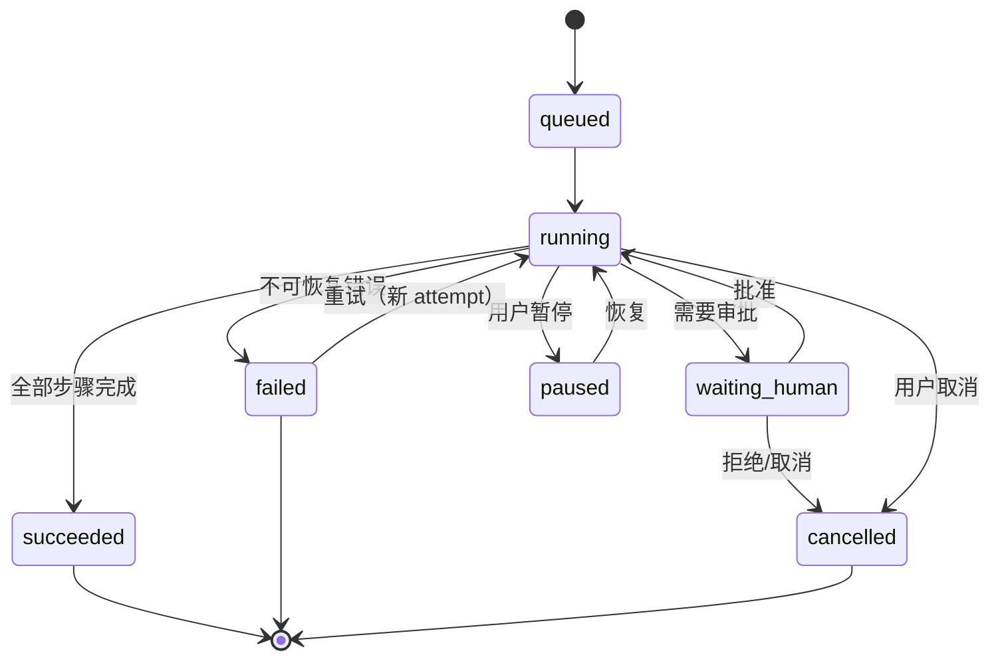
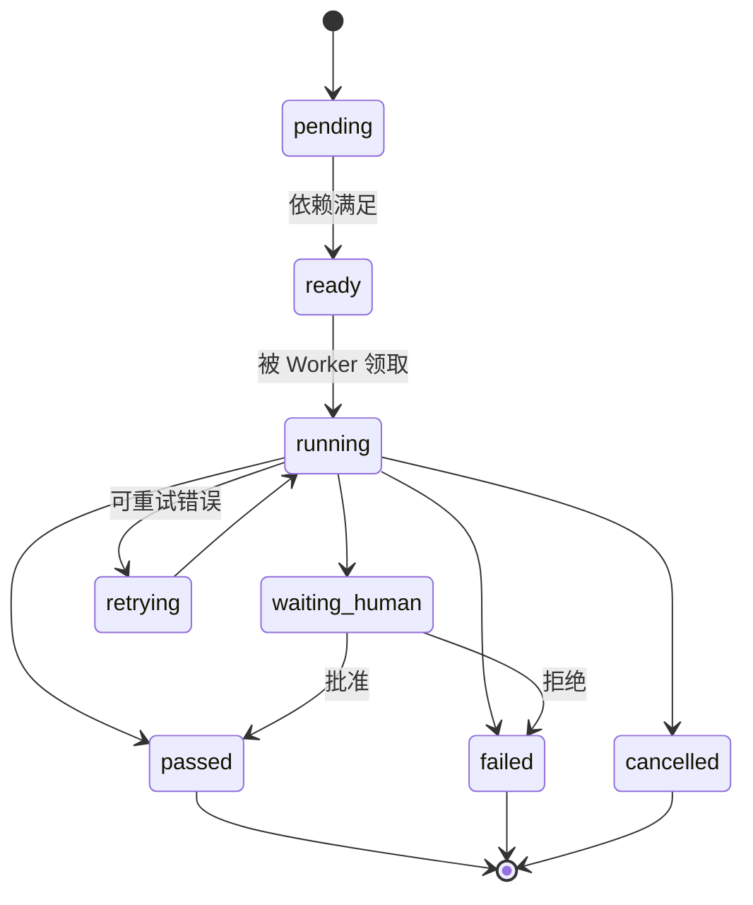

# 02 · 领域模型与契约

> 本文定义平台的核心概念、因子规范 DSL、状态机、数据库模型与版本规则。  
> 上游：[系统架构](01-system-architecture.md)　下游：[Agent 系统](03-agent-system.md)

---

## 1. 概念全景



---

## 2. 核心概念

| 概念 | 定义 | 关键约束 |
|---|---|---|
| **Source（来源）** | 论文、网页、策略库、数据集等外部信息源 | 记录 URL、许可、抓取时间、内容哈希 |
| **Document（文档）** | 来源的一次快照（PDF/HTML/文本/表格） | 内容不可变；只存允许存储的部分 |
| **Hypothesis（假设）** | 从文档中提取的经济逻辑与可检验陈述 | 必须带原文引用；区分“作者结论”与“Agent 推断” |
| **Factor（因子）** | 将面板数据映射为信号值的定义 | 不含持仓；有唯一 ID 与版本链 |
| **FactorVersion（因子版本）** | 因子的一次不可变实现 | 代码/DSL 哈希固定；任何修改产生新版本 |
| **Trial（试验）** | 一次“因子版本 × 参数 × 数据快照 × 验证配置”的评估 | **所有试验必须登记**，包括失败 |
| **Family（因子族）** | 预登记的、一起做多重检验的试验集合 | 族定义在评估前写入，事后不可扩大 |
| **Strategy（策略）** | 因子 + 组合构建 + 交易假设 | 与因子分离，可复用多个因子 |
| **ValidationProfile（验证配置）** | 一组门槛阈值与检验参数 | 版本化；报告记录其哈希 |
| **Gate（门槛）** | 验证流水线中的检查点 G0–G7 | 结果不可修改；人工豁免需理由与审批 |
| **DataSnapshot（数据快照）** | 不可变的数据版本清单 | 任何试验/回测/报告必须绑定 |
| **Holdout（隔离样本）** | 最终验证专用、只解锁一次的样本外数据 | 独立存储、一次性令牌、不可变账本 |
| **Artifact（产物）** | 报告、图表、因子值、日志等文件 | 内容寻址（sha256），带血缘 |
| **ResearchTask（研究任务）** | 一次完整研究流程 | 有预算、优先级、状态机 |
| **TaskStep（步骤）** | DAG 节点 | 幂等、可重试、有产物 |

### 2.1 因子、策略、试验三者的关系

```text
Hypothesis
   └─ Factor (逻辑定义)
        └─ FactorVersion (不可变实现)
             ├─ Trial A: params={w:20}, snapshot=S1  → 失败
             ├─ Trial B: params={w:30}, snapshot=S1  → 通过 G1–G4
             └─ Trial C: params={w:20, neutralize: size} → 通过
                  └─ Strategy (组合构建) → Backtest → G5/G6 → OOS
```

**关键点**：通过验证的是 `FactorVersion + params + snapshot` 的组合，而不是抽象意义上的“因子”。报告中必须写明测试了哪些变体、共多少次。

---

## 3. FactorSpec DSL v1

### 3.1 设计目标

- **可静态审计**：解析成 AST 后可检查未来函数、非法算子、全样本统计。
- **可缓存**：规范化后的表达式生成稳定哈希。
- **可移植**：同一 DSL 可映射到 Polars（研究）与事件驱动引擎（回测）。
- **受限**：默认不允许任意 Python、网络、文件、随机数。

### 3.2 规范结构

```yaml
apiVersion: quant/v1
kind: Factor
metadata:
  id: fac_7f3a2c
  name: crypto_momentum_20d
  version: 1
  status: candidate          # draft | candidate | validated | promoted | rejected | quarantined
  created_at: 2026-10-17T10:00:00Z
  created_by: agent:implementer@v3

spec:
  market: crypto_perp         # crypto_perp | cn_equity | us_equity ...
  scope: cross_sectional      # cross_sectional | time_series
  frequency: 1d               # 1m | 1h | 4h | 1d
  horizon: 1d                 # 预测/持有期，用于标签与 Purge
  universe:
    type: top_n_by_quote_volume
    n: 100
    as_of: rebalance          # 成分股必须按决策时点取，禁止当前成分回填
  inputs:
    - name: close
      source: market.kline
      fields: [close]
      availability_lag: 0s
    - name: quote_volume
      source: market.kline
      fields: [quote_volume]
      availability_lag: 0s
  params:
    window:
      type: int
      default: 20
      grid: [10, 15, 20, 25, 30]
    min_periods:
      type: int
      default: 15
  expression: |
    cs_rank(ts_return(close, window), method="average")
  preprocessing:
    order: [winsorize, neutralize, standardize, fill]
    winsorize:
      method: quantile
      limits: [0.01, 0.99]
      scope: cross_section
    neutralize:
      exposures: [log_market_cap, industry]
      method: ols
    standardize:
      method: cross_section_zscore
    fill:
      method: cross_section_median
      max_missing_ratio: 0.3
  direction: long_high         # long_high | long_low
  economic_rationale: >
    过去 20 日收益率的截面排名捕捉短期动量/反转；在加密货币市场，
    高流动性合约的动量可能因趋势跟随资金流而延续。
  provenance:
    hypothesis_id: hyp_91c2
    source_ids: [src_arxiv_2501_01234]
    quotes:
      - "Momentum persists in cryptocurrency markets over 1-4 week horizons..."
    generated_by: agent:implementer@v3
    review_status: pending     # pending | approved | rejected
```

### 3.3 表达式语言

**算子白名单**（首期）：

| 类别 | 算子 | 语义/因果性 |
|---|---|---|
| 时序 | `ts_mean`, `ts_std`, `ts_sum`, `ts_min`, `ts_max`, `ts_rank`, `ts_return`, `ts_delta`, `ts_corr`, `ts_cov`, `ts_zscore` | 只允许 `window >= 1` 的向后窗口，默认 `min_periods` 必须显式 |
| 时序 | `ts_shift(x, n)` | **仅允许 `n >= 0`**；`n < 0` 视为未来函数，编译失败 |
| 时序 | `ts_ema`, `ts_decay_linear` | 因果递推 |
| 截面 | `cs_rank`, `cs_zscore`, `cs_demean`, `cs_winsorize`, `cs_quantile` | 仅在同一时间戳内计算 |
| 数学 | `abs`, `log`, `sign`, `sqrt`, `clip`, `where`, `add`, `sub`, `mul`, `div`, `pow` | 纯函数 |
| 聚合 | `group_mean`, `group_rank`, `group_zscore` | 按行业/板块分组，分组字段必须 PIT |
| 条件 | `where(cond, x, y)` | 无状态 |

**禁止**：

- 任意 Python 代码、`eval`、`exec`、`import`、文件/网络访问。
- `ts_shift(x, -n)`、`lead`、`future_*`、`center=True` 的滚动窗口。
- 全样本统计（如用整个样本的均值/方差做标准化）。
- `bfill`、插值到未来、用当前成分股回填历史。
- 随机数（除非显式声明 `stochastic: true` 并记录 seed）。

**Python 兜底**：复杂因子可声明 `implementation: python`，代码必须：

1. 通过 AST 白名单检查（仅允许 `polars`, `numpy`, `math` 等）；
2. 在沙箱中运行；
3. 通过 PIT 回放测试；
4. 由人工/Critic 复核后才可进入 Trial Registry。

### 3.4 预处理顺序

固定顺序，避免不同实现产生不同结果：

1. **缺失处理**：按 `fill` 配置；截面中缺失比例超过阈值则当日无效。
2. **去极值**：按截面分位数 Winsorize（默认 1%/99%）。
3. **中性化**：对指定暴露做截面 OLS，取残差；暴露必须 PIT。
4. **标准化**：截面 z-score 或 rank。
5. **方向调整**：`long_low` 在信号层取负，确保“分数越高越看多”。

> 所有截面操作严格按 `timestamp` 分组；所有时序操作严格向后看。预处理参数进入缓存键。

### 3.5 两种 scope 的语义差异

| 维度 | `cross_sectional` | `time_series` |
|---|---|---|
| 信号含义 | 同一时刻跨标的的相对排序 | 单个标的随时间的方向/强度 |
| 典型市场 | A 股、美股 | 加密永续、CTA、单标的 |
| 主检验 | Rank IC、分层多空 | 信号-收益相关性、逐标的分组、时序 Sharpe |
| 组合构建 | 截面排序选股 | 按信号方向/阈值持仓 |
| 中性化 | 市值/行业 | 通常不做截面中性化 |
| 多重检验 | 因子族 | 策略变体族 |
| 现有代码 | 新增 | `EmaStrategy` 属于此类 |

**架构要求**：不要把截面 IC 作为时序策略的硬门槛。`ValidationProfile` 根据 `scope` 选择不同的 Gate 实现与阈值。

---

## 4. StrategySpec

```yaml
apiVersion: quant/v1
kind: Strategy
metadata:
  id: stg_...
  name: crypto_xs_momentum_ls
  version: 1
spec:
  market: crypto_perp
  frequency: 1d
  factors:
    - factor_id: fac_7f3a2c
      version: 1
      weight: 1.0
  portfolio:
    method: quantile_long_short   # equal_weight | ic_weight | quantile_long_short | risk_parity
    quantiles: 5
    long_top: 1
    short_bottom: 1
    gross_exposure: 1.0
    max_position: 0.05
    rebalance: 1d
    holding_period: 1d
  execution:
    delay: 1 bar                  # 信号后延迟执行，防止同日收盘价成交
    cost_model: crypto_perp_v1
    slippage_bps: 3
    fee_bps: 5
    funding: true
  constraints:
    min_liquidity: 10_000_000
    max_turnover: 1.0
```

**执行时点必须显式**：`decision_time → execution_time → label_end` 三者写入回测配置，防止“用收盘价信号按收盘价成交”的隐性未来函数。

---

## 5. ValidationProfile

```yaml
apiVersion: quant/v1
kind: ValidationProfile
metadata:
  id: crypto_perp_daily_v1
  market: crypto_perp
  frequency: 1d
  scope: cross_sectional
  version: 1

thresholds:
  g1_ic:
    rank_ic_mean_min: 0.02
    icir_min: 0.40
    ic_win_rate_min: 0.52
    t_stat_min: 2.0
    min_periods: 365
    subperiod_positive_ratio_min: 0.60
  g2_quantile:
    n_quantiles: 5
    monotonicity_min: 0.70
    long_short_t_stat_min: 2.0
    turnover_max: 1.0
  g3_robustness:
    plateau_coverage_min: 0.60
    plateau_tolerance: 0.20
    regime_positive_min: 2          # 至少 2/3 市场状态为正
    permutation_p_max: 0.05
    permutation_b: 1000
    bootstrap_b: 2000
    cost_multipliers: [1, 2, 3]
  g4_redundancy:
    max_abs_corr: 0.50
    residual_rank_ic_min: 0.01
    residual_t_stat_min: 2.0
    duplicate_corr: 0.80
  g5_group:
    fdr_q: 0.10
    pbo_max: 0.30
    cscv_splits: 10              # 最终确认可提高到 16（计算量更大）
    dsr_p_max: 0.05
  g6_strategy:
    cpcv_groups: 6
    cpcv_test_groups: 2
    purge: label_horizon          # 删除与测试期标签窗口重叠的训练样本
    embargo_pct: 0.01
    oos_sharpe_min: 0.5
    dsr_p_max: 0.05
    max_drawdown_p95: 0.40
    ruin_probability_max: 0.05
  g7_holdout:
    min_rank_ic: 0.0
    min_sharpe: 0.0
    dsr_p_max: 0.10
    degradation_tolerance: 0.50      # OOS Sharpe >= 50% IS Sharpe
```

> 阈值是**配置**而非代码。初始值需用负对照（随机因子、标签置换）校准后再冻结。

---

## 6. Trial（试验）定义

```yaml
trial_id: trl_01J...
factor_id: fac_7f3a2c
factor_version: 1
params:
  window: 20
  min_periods: 15
preprocessing_hash: sha256:...
data_snapshot_id: snap_2026_10_17
validation_profile_id: crypto_perp_daily_v1
family_id: fam_momentum_crypto_2026Q4
code_hash: sha256:...
environment_hash: sha256:...
seed: 42
status: evaluated            # registered | running | evaluated | failed | quarantined
metrics_uri: s3://.../trial/trl_.../metrics.json
created_at: 2026-10-17T10:05:00Z
```

**规则**

1. 在计算开始前写入 `registered`（预登记），计算完成后更新为 `evaluated/failed`。
2. 同一 `(factor_version, params, snapshot, profile)` 只允许一个有效 Trial；重复请求返回已有记录。
3. 失败的 Trial 也保留，且计入 `N_eff` 与 FDR 的分母（无有效 p 值的隔离试验按最保守方式计入）。
4. `family_id` 必须在族内第一次试验前创建，事后不可把新试验塞进旧族以“稀释”校正。
5. `params` 必须规范化（键排序、数值格式统一）后再计算唯一键/哈希，避免同一组参数因字段顺序不同产生重复 Trial。

---

## 7. 状态机

### 7.1 研究任务



### 7.2 步骤



### 7.3 因子生命周期

```text
draft ──► candidate ──► g1_g4_passed ──► g5_passed ──► g6_passed ──► oos_confirmed ──► promoted
  │           │              │               │              │
  └───────────┴──────────────┴───────────────┴──────────────┴──► rejected / quarantined
```

- `quarantined`：疑似未来函数/数据问题，保留证据，等待复核。
- `rejected`：明确未通过，不可直接复用；如要再试，产生新 `FactorVersion` 与新 Trial。
- `promoted`：仅表示“研究通过”，不等于实盘可用。

---

## 8. 数据库模型

> 以下为逻辑模型；实现时用 SQLAlchemy 2.0 + Alembic。JSONB 用于灵活指标，但关键过滤字段必须独立列。

### 8.1 任务与事件

```sql
research_tasks (
  id              text primary key,          -- ulid
  title           text not null,
  goal            text not null,
  market          text not null,
  scope           text not null,
  config          jsonb not null,            -- sources, budget, profile_id...
  status          text not null,             -- queued/running/waiting_human/...
  priority        int  not null default 0,
  budget_tokens   bigint,
  budget_compute  numeric,
  spent_tokens    bigint default 0,
  created_by      text,
  created_at      timestamptz not null,
  started_at      timestamptz,
  finished_at     timestamptz,
  error           jsonb
);

task_steps (
  id              text primary key,
  task_id         text not null references research_tasks(id),
  step_key        text not null,             -- scout, extract, implement, g0...
  step_type       text not null,
  status          text not null,
  attempt         int not null default 1,
  max_attempts    int not null default 3,
  depends_on      text[] not null default '{}',
  input_hash      text,
  cache_key       text,
  lease_until     timestamptz,
  heartbeat_at    timestamptz,
  progress        numeric default 0,
  message         text,
  result          jsonb,
  started_at      timestamptz,
  finished_at     timestamptz,
  unique (task_id, step_key)
);

task_events (
  seq             bigserial primary key,
  task_id         text not null,
  step_id         text,
  type            text not null,
  level           text not null default 'info',
  message         text,
  data            jsonb not null default '{}',
  created_at      timestamptz not null default now()
);
create index on task_events (task_id, seq);
```

### 8.2 来源与假设

```sql
sources (
  id              text primary key,
  kind            text not null,             -- paper/preprint/web/strategy_library/api
  name            text not null,
  url             text,
  license         text,
  access_policy   text,                      -- open/abstract_only/institutional/api
  connector       text,                      -- 对应 SourceConnector
  enabled         boolean default true,
  rate_limit      jsonb,
  created_at      timestamptz not null
);

documents (
  id              text primary key,
  source_id       text references sources(id),
  title           text,
  authors         text[],
  published_at    timestamptz,
  fetched_at      timestamptz not null,
  content_uri     text,                      -- 允许存储时才有
  content_hash    text not null,
  abstract        text,
  metadata        jsonb,
  license_status  text not null
);

hypotheses (
  id              text primary key,
  document_id     text references documents(id),
  task_id         text references research_tasks(id),
  claim           text not null,
  rationale       text,
  signal_logic    text,
  required_data   jsonb,
  universe        text,
  horizon         text,
  quotes          jsonb not null,            -- 原文引用与页码
  confidence      numeric,
  status          text not null,             -- proposed/approved/rejected
  created_by      text,
  created_at      timestamptz not null
);
```

### 8.3 因子与试验

```sql
factors (
  id              text primary key,
  name            text not null,
  market          text not null,
  scope           text not null,
  hypothesis_id   text references hypotheses(id),
  current_version int not null default 1,
  status          text not null,
  created_at      timestamptz not null
);

factor_versions (
  factor_id       text not null references factors(id),
  version         int not null,
  spec            jsonb not null,            -- 完整 FactorSpec
  code_hash       text not null,
  spec_hash       text not null,             -- 规范化后哈希，用于去重
  origin          text not null,             -- agent/manual/imported
  review_status   text not null,
  created_at      timestamptz not null,
  primary key (factor_id, version)
);

trials (
  id              text primary key,
  factor_id       text not null,
  factor_version  int not null,
  family_id       text not null,
  params          jsonb not null,
  data_snapshot_id text not null,
  profile_id      text not null,
  seed            bigint,
  status          text not null,
  metrics         jsonb,
  p_value         numeric,
  sharpe          numeric,
  rank_ic         numeric,
  code_hash       text not null,
  environment_hash text not null,
  artifacts       text[] default '{}',
  created_at      timestamptz not null,
  finished_at     timestamptz,
  unique (factor_id, factor_version, params, data_snapshot_id, profile_id)
);
create index on trials (family_id, status);
```

### 8.4 验证与门槛

```sql
validation_runs (
  id              text primary key,
  factor_id       text,
  factor_version  int,
  strategy_id     text,
  strategy_version int,
  trial_ids       text[] not null,
  profile_id      text not null,
  profile_hash    text not null,
  data_snapshot_id text not null,
  status          text not null,
  verdict         text,                      -- passed/rejected/quarantined
  report_uri      text,
  environment_hash text not null,
  started_at      timestamptz,
  finished_at     timestamptz
);

gate_results (
  id              text primary key,
  validation_run_id text not null references validation_runs(id),
  gate_id         text not null,             -- G0..G7
  status          text not null,             -- passed/failed/waived/skipped
  metrics         jsonb not null default '{}',
  reason          text,
  evidence        jsonb not null default '{}', -- 阈值、样本量、图表 URI
  waived_by       text,
  waived_reason   text,
  created_at      timestamptz not null,
  unique (validation_run_id, gate_id)
);
```

### 8.5 策略与回测

```sql
strategies (
  id              text primary key,
  name            text not null,
  market          text not null,
  current_version int not null default 1,
  status          text not null
);

strategy_versions (
  strategy_id     text not null,
  version         int not null,
  spec            jsonb not null,
  code_hash       text not null,
  created_at      timestamptz not null,
  primary key (strategy_id, version)
);

backtests (
  id              text primary key,
  strategy_id     text not null,
  strategy_version int not null,
  trial_id        text,
  engine          text not null,             -- vectorized/event_driven
  config          jsonb not null,            -- costs, delay, universe...
  data_snapshot_id text not null,
  metrics         jsonb,
  equity_uri      text,
  trades_uri      text,
  status          text not null,
  started_at      timestamptz,
  finished_at     timestamptz
);
```

### 8.6 数据、产物、金库、审计

```sql
data_snapshots (
  id              text primary key,
  market          text not null,
  start_date      date,
  end_date        date,
  manifest_uri    text not null,
  manifest_hash   text not null,
  row_counts      jsonb,
  created_at      timestamptz not null
);

artifacts (
  id              text primary key,
  sha256          text not null unique,
  uri             text not null,
  media_type      text not null,
  size_bytes      bigint not null,
  producer_step   text,
  lineage         jsonb not null default '{}', -- 输入 artifact/trial/snapshot
  created_at      timestamptz not null
);

holdout_segments (
  id              text primary key,
  market          text not null,
  scope           text not null,
  start_date      date not null,
  end_date        date not null,
  manifest_hash   text not null,
  status          text not null,             -- sealed/unlocked/consumed
  created_at      timestamptz not null
);

holdout_unlocks (
  id              text primary key,
  segment_id      text not null references holdout_segments(id),
  validation_run_id text not null,
  requested_by    text not null,
  approved_by     text,
  reason          text not null,
  token_hash      text not null,
  used_at         timestamptz,
  result_uri      text,
  prev_hash       text,
  entry_hash      text not null,             -- 哈希链，防篡改
  created_at      timestamptz not null
);

llm_calls (
  id              text primary key,
  task_id         text,
  step_id         text,
  role            text,
  model           text not null,
  prompt_hash     text not null,
  input_tokens    int,
  output_tokens   int,
  cost_usd        numeric,
  latency_ms      int,
  status          text,
  created_at      timestamptz not null
);

audit_log (
  seq             bigserial primary key,
  actor           text not null,             -- user/agent/worker
  action          text not null,
  object_type     text not null,
  object_id       text not null,
  before          jsonb,
  after           jsonb,
  request_id      text,
  created_at      timestamptz not null default now()
);
```

### 8.7 其他

```sql
validation_profiles (       -- 也可只放文件系统，DB 存元数据
  id              text primary key,
  version         int not null,
  market          text not null,
  scope           text not null,
  config          jsonb not null,
  config_hash     text not null,
  active          boolean default true
);

workers (
  id              text primary key,
  queue           text not null,
  hostname        text,
  pid             int,
  status          text not null,
  last_heartbeat  timestamptz,
  current_step_id text,
  concurrency     int
);

notifications (
  id              text primary key,
  user_id         text,
  task_id         text,
  type            text not null,
  payload         jsonb not null,
  read_at         timestamptz,
  created_at      timestamptz not null
);
```

---

## 9. 版本与哈希规则

| 对象 | 版本方式 | 哈希输入 |
|---|---|---|
| Factor | 单调递增 `version` | 规范化 spec + 代码 + 依赖声明 |
| FactorSpec | 语义化字段 | 排序后的 JSON（去除注释/空白） |
| Strategy | 单调递增 `version` | 规范化 strategy spec |
| ValidationProfile | 单调递增 `version` | YAML 规范化 + 门槛实现版本 |
| DataSnapshot | 日期 + manifest 哈希 | 所有输入文件 sha256 的有序列表 |
| Artifact | 内容寻址 | 文件内容 sha256 |
| Environment | 构建时生成 | Python 版本 + lockfile + 镜像 digest |

**不可变规则**：`factor_versions`、`strategy_versions`、`validation_runs`、`gate_results`、`holdout_unlocks`、`audit_log` 只追加，不更新关键字段；修正通过新版本/新记录表达。

---

## 10. 产物与血缘

每个 Artifact 的 `lineage` 至少包含：

```json
{
  "task_id": "tsk_...",
  "step_id": "stp_...",
  "inputs": [
    {"artifact_id": "art_...", "sha256": "..."},
    {"snapshot_id": "snap_..."}
  ],
  "code": {"commit": "abc123", "environment_hash": "..."},
  "params": {"window": 20},
  "generated_at": "2026-10-17T10:00:00Z"
}
```

**可复现判定**：给定 `report_uri`，能沿血缘找到所有输入，并用相同环境重算出相同哈希（浮点指标允许容差）。

---

## 11. 示例：一个完整对象链

```text
src_arxiv_2501_01234
  └─ doc_9f2...
       └─ hyp_91c2  "20 日动量在加密市场延续"
            └─ fac_7f3a2c  crypto_momentum_20d
                 ├─ v1: expression=cs_rank(ts_return(close,20))
                 │    ├─ trl_A: window=20, snapshot=S1 → G1 通过, G2 失败
                 │    ├─ trl_B: window=30, snapshot=S1 → G1 通过, G2 通过, G3 失败
                 │    └─ trl_C: window=20, winsorize=1%, neutralize=size → 通过 G1–G4
                 │         └─ stg_... → backtest → G5/G6 → OOS
                 └─ v2: 加入波动率调整（新假设/新试验，不能复用 OOS）
```

注意：`v2` 不能使用已经解锁过的同一段 OOS 数据；金库按“因子族/策略族”记录消耗，防止换版本绕过。

---

## 12. 设计检查清单

实现前逐项确认：

- [ ] `FactorSpec` 能否表达截面与时序两类策略？
- [ ] 每个数据字段是否都有 `available_at`？
- [ ] Trial 是否在计算前登记，失败是否保留？
- [ ] Family 是否在验证前创建，是否记录所有变体？
- [ ] 报告是否绑定 `snapshot + code + environment + profile`？
- [ ] Gate 结果是否不可变，人工豁免是否留痕？
- [ ] OOS 是否独立存储、一次性、账本可验证？
- [ ] 因子/策略版本是否不可变，修改是否产生新版本？
