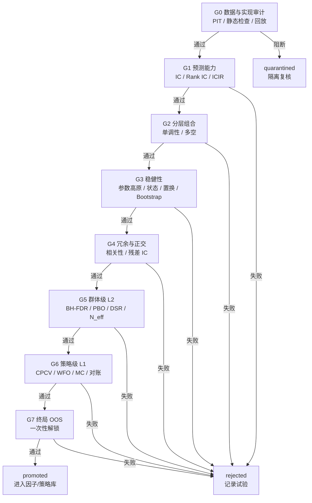

# 04 · 验证流水线（G0–G7）

> 本文把“基础统计检验 + 抗拟合验证”落成**可执行、可配置、不可绕过**的门槛。  
> 上游：[领域模型](02-domain-model.md)　下游：[数据平台](05-data-platform.md)

---

## 1. 设计原则

1. **门槛化**：每个阶段输出结构化 `GateResult`（通过/失败/豁免），不允许“口头通过”。
2. **先便宜后昂贵**：G0–G2 快速淘汰大部分噪声；G3–G4 做稳健性与冗余；G5–G6 才做重计算；G7 最后一次性解锁。
3. **配置化**：阈值来自 `ValidationProfile`，按市场、频率、scope 版本化。
4. **全试验登记**：FDR/DSR 的分母包含所有尝试，包括失败；否则校正无效。
5. **预登记**：参数网格、因子族、市场状态定义在评估前写入，禁止事后扩大。
6. **负对照校准**：随机因子、标签置换、未来污染因子用于验证流水线本身没有泄漏。
7. **不可变证据**：每个门槛保存指标、样本量、阈值、图表和输入哈希。

---

## 2. 流水线总览



**顺序说明**

- 需求中的 “L2 群体级” 与 “L1 策略级” 命名保留，便于对照；本文对应 G5 与 G6。
- G1–G4 是对单个候选的检验；G5 是对**一族候选**的选择偏差校正；G6 是对**可交易策略**的最终抗拟合检验。
- G5 的 FDR 分母应使用**预登记族内的全部试验**，而不是只用在 G1–G4 存活的试验；否则“先筛选再校正”会低估假阳性。报告中同时给出两种口径。

---

## 3. 市场与 scope Profile

| 参数 | `crypto_perp_daily_v1`（建议初值） | `cn_equity_daily`（需求给定） | 说明 |
|---|---|---|---|
| scope | cross_sectional / time_series | cross_sectional | 加密两者都支持 |
| Rank IC 均值 | ≥ 0.02 | ≥ 0.03 | 加密标的少、噪声大，阈值单独校准 |
| ICIR | ≥ 0.40 | ≥ 0.50 | 非年化口径 |
| IC 胜率 | ≥ 52% | ≥ 55% | 方向调整后 |
| IC t 统计量 | ≥ 2.0 | ≥ 2.0 | Newey-West |
| 分层数 | 5 | 5 或 10 | 标的少时用 5 |
| 单调性 | ≥ 0.70 | ≥ 0.80 | Spearman |
| 最大 \|相关\| | ≤ 0.50 | < 0.30 | 加密因子库较小 |
| PBO | ≤ 0.30 | ≤ 0.30 | CSCV |
| DSR p | < 0.05 | < 0.05 | 通缩后 |
| 最小样本 | 365 天 | 24 个月 | 需要足够截面/时间 |

> **这些是起点，不是真理。** 必须用负对照（随机因子、标签置换）在目标市场上估计零分布，再校准阈值；报告中记录校准日期与样本。

### 3.1 时序 scope 的替代指标

对 `time_series` 策略，不强制 Rank IC，改用：

- 信号与未来收益的**时序相关性**（逐标的，Fisher z 汇总）；
- 信号分组（按信号强度分桶）的未来收益单调性；
- 逐标的 Walk-Forward Sharpe 分布；
- 组合层面 CPCV/DSR；
- 状态依赖（趋势/震荡/高波动）下的表现。

G1 的 `Gate` 实现按 `scope` 分派，阈值仍在 Profile 中配置。

---

## 4. G0 · 数据质量与实现审计

### 4.1 检查项

| 编号 | 检查 | 方法 | 失败处理 |
|---|---|---|---|
| G0.1 | 数据契约完整 | 字段存在、类型、频率、时区、`available_at` | 阻断 |
| G0.2 | PIT 回放 | 截断数据重算，比较 `f_truncated(t)` 与 `f_full(t)` | 阻断 + 隔离 |
| G0.3 | 静态 AST 审计 | 负向 shift、全样本统计、未来字段、非法算子 | 阻断 |
| G0.4 | 标签时点 | `decision_time < execution_time <= label_end` | 阻断 |
| G0.5 | Universe PIT | 成分/排名按决策时点取，禁止当前成分回填 | 阻断 |
| G0.6 | 覆盖率 | 有效截面 ≥ 80%；单标的缺失 ≤ 30% | 警告/阻断 |
| G0.7 | 极值分布 | 分位数、最大/最小、无穷值、重复时间戳 | 警告 |
| G0.8 | 负对照 | 随机因子应失败；未来污染因子应被 G0.2 捕获 | 流水线故障告警 |

### 4.2 PIT 回放测试

对采样时点 `t`：

```text
f_trunc = compute(factor, data[available_at <= t])
f_full  = compute(factor, data)[t]
assert |f_trunc - f_full| <= tol
```

采样覆盖：

- 财报/公告发布日前后（A 股）；
- 指数/成分股调整日；
- 资金费率结算时点（加密）；
- 极端行情、数据缺失、时区边界；
- 至少 20 个随机时点。

**强规则**：任一采样不一致 → `quarantined`，由人工/Critic 复核；不得自动放行。

### 4.3 未来函数静态规则

| 模式 | 例子 | 处理 |
|---|---|---|
| 负向位移 | `ts_shift(x, -1)`, `lead(x)` | 阻断 |
| 居中窗口 | `rolling(center=True)` | 阻断 |
| 全样本标准化 | 用全样本均值/方差 | 阻断 |
| 未来字段 | 读取 `forward_return`, `label`, `target` | 阻断 |
| 前向填充未来 | `bfill`, 反向插值 | 阻断 |
| 当前成分回填 | `universe=current` 用于历史 | 阻断 |
| 同日收盘成交 | 信号与成交都用同一收盘价 | 阻断（除非显式 `execution.delay=0` 且声明） |
| 幸存者偏差 | 只保留当前存续标的 | 阻断 |

### 4.4 通过标准

- 所有 `blocking` 项为 0；
- PIT 回放全部通过；
- 覆盖率达标；
- 负对照结果符合预期。

---

## 5. G1 · 预测能力（IC / Rank IC）

### 5.1 计算

对每个决策时点 `t`（截面）：

\[
IC_t = \mathrm{corr}\left(f_{i,t},\ r_{i,t+1}\right)
\]

\[
RankIC_t = \mathrm{Spearman}\left(f_{i,t},\ r_{i,t+1}\right)
\]

其中：

- \(f_{i,t}\) 是方向调整后的因子值（`long_low` 取负）；
- \(r_{i,t+1}\) 是 `execution_time` 到 `label_end` 的收益；
- 截面样本数不足（如 < 20）的时点剔除并记录。

汇总：

\[
\overline{IC} = \frac{1}{T}\sum_t IC_t,\qquad
ICIR = \frac{\overline{IC}}{\mathrm{std}(IC_t)}
\]

\[
t_{NW} = \frac{\overline{IC}}{\mathrm{SE}_{NW}(\overline{IC})}
\]

- Newey-West 滞后阶数：`max(horizon-1, floor(4*(T/100)^(2/9)))`，可配置；
- IC 胜率 = \(\#\{IC_t > 0\}/T\)；
- 子期稳定性：按年/半年切分，正 IC 子期占比；
- IC 衰减：horizon = 1, 2, 5, 10, 20 的 Rank IC 曲线。

### 5.2 通过标准（截面）

| 指标 | 默认 |
|---|---|
| \|Mean Rank IC\| | ≥ 0.02（加密）/ 0.03（A 股） |
| ICIR | ≥ 0.40 / 0.50 |
| IC 胜率 | ≥ 52% / 55% |
| t 统计量 | ≥ 2.0 |
| 有效样本 | ≥ 365 天 / 24 个月 |
| 子期正 IC 占比 | ≥ 60% |

### 5.3 时序 scope

- 逐标的计算信号与未来收益的 Spearman 相关，用 Fisher z 汇总；
- 要求汇总相关显著（t ≥ 2），且正相关标的占比 ≥ 60%；
- 同时报告逐标的分布，避免少数标的撑起整体。

### 5.4 失败诊断

- IC 均值接近 0：逻辑不成立或方向错误；
- IC 高但 ICIR 低：不稳定，可能依赖少数时段；
- IC 衰减过快：持有期/执行延迟不匹配；
- 子期符号翻转：状态依赖，进入 G3 重点检查。

---

## 6. G2 · 分层组合与单调性

### 6.1 构建

在每个 `t`：

1. 按因子值排序，分成 \(Q\) 组（5 或 10）；
2. 组内等权（或按流动性加权，Profile 配置）；
3. 持有 `horizon`，按 `execution.delay` 成交；
4. 计算各组未来收益、多空组合 \(LS_t = R_{Q,t} - R_{1,t}\)（方向调整后）；
5. 扣除换手成本（至少 1x 成本）。

### 6.2 指标

\[
Monotonicity = \mathrm{Spearman}\left(q,\ \bar{R}_q\right),\quad q=1..Q
\]

- 多空年化收益、Sharpe、最大回撤；
- 多空 t 统计量（Newey-West）；
- 换手率、持仓集中度、容量粗估；
- 各组收益的置信区间（bootstrap）。

### 6.3 通过标准

| 指标 | 默认 |
|---|---|
| 单调性 | ≥ 0.70（加密）/ 0.80（A 股） |
| 多空 t | ≥ 2.0 |
| 多空 Sharpe | > 0（扣成本后） |
| 换手 | ≤ Profile 上限 |
| 极端组依赖 | Top/Bottom 贡献 < 70% 总收益 |

### 6.4 非单调但多空显著

不要直接通过，也不要直接丢弃：

1. 检查是否由极值驱动 → 去极值后重测；
2. 检查中间组是否因行业/市值集中 → 中性化后重测；
3. 若仍非单调，标记 `warning`，由 Critic 判断经济逻辑是否支持“只做极端组”；
4. 任何修改都产生新 Trial，计入族。

---

## 7. G3 · 参数与条件敏感性（稳健性）

### 7.1 参数高原

在**预登记**的网格 \(G\) 上计算指标 \(m(g)\)（Rank IC 或扣成本 Sharpe）：

\[
PlateauCoverage = \frac{1}{|G|}\sum_{g \in G} \mathbf{1}\left[m(g) \ge (1-\tau)\max_{g'} m(g')\right]
\]

- \(\tau\) = `plateau_tolerance`，默认 0.20；
- 同一符号比例；
- 平滑度：相邻网格点的平均绝对差 / 指标尺度；
- 尖峰检测：最优点邻域是否全部显著低于最优点。

**通过**：`PlateauCoverage ≥ 0.60`，且最优点不是孤立尖峰，且至少 2 个相邻参数也达标。

> 若指标可能为负（如扣成本 Sharpe），先统一方向（取负或转为相对最优值的差距），再计算覆盖率；报告中注明变换方式，避免“负得少”被误判为高原。

### 7.2 市场状态

状态定义必须**事前**、可复现：

| 状态 | 定义示例 |
|---|---|
| 牛市 | 基准指数 60 日收益 > +10% |
| 熊市 | 基准指数 60 日收益 < -10% |
| 震荡 | 其余 |
| 高波动 | 已实现波动率 > 过去 1 年 70% 分位 |
| 低波动 | < 30% 分位 |
| 高流动性 | 成交额 > 70% 分位 |
| 低流动性 | < 30% 分位 |

**通过**：

- 至少 2/3 状态为正；
- 任一状态贡献不超过总 PnL 的 60%；
- 不得只用一段牛市解释全部收益。

### 7.3 置换检验

目标：验证“因子与收益的关系”不是偶然。

方法（二选一，Profile 配置）：

1. **循环块位移**：把因子值按时间块循环位移，保留自相关，破坏与收益的对应；
2. **块 Bootstrap**：对收益序列做 stationary block bootstrap，保持波动聚集。

统计量：使用**网格上的最大值**（max statistic），以控制参数搜索的多重性：

\[
p = \frac{1 + \#\{b: m^*_b \ge m_{obs}\}}{B+1}
\]

**通过**：`p < 0.05`，B ≥ 1000。

### 7.4 Bootstrap 风险

对多空/策略日收益做 stationary block bootstrap（B ≥ 2000）：

- Sharpe 的 95% CI；
- 最大回撤分布：P(MDD > 30%/40%/50%)；
- 最差 5% 路径的终值；
- 破产概率（若适用杠杆）。

### 7.5 成本与实现敏感性

- 成本 1x / 2x / 3x；
- 滑点 ±50%；
- 执行延迟 0/1/2 bar；
- Universe top 50 vs top 100；
- 频率 1d vs 4h；
- 去极值参数 ±；
- 缺失数据注入（随机 5%/10%）。

**通过**：在 2x 成本下仍为正；关键结论不因单一实现假设翻转。

---

## 8. G4 · 冗余与正交化

### 8.1 相关性

与以下因子库比较：

- **风险因子**：市值、动量、波动率、流动性、估值、成长、杠杆；
- **Fama-French**：MKT, SMB, HML, RMW, CMA（A 股/美股）；
- **行业/板块**；
- **平台内部因子库**（已通过验证的因子）；
- **基准策略收益**（时序 scope）。

计算两种相关性：

1. **截面因子值相关**：每个 `t` 计算 Spearman，取时间平均；
2. **因子收益/IC 序列相关**：因子多空收益与已知因子收益的时序相关。

\[
\rho_{max} = \max_k |\rho(f, k)|
\]

### 8.2 正交化与残差检验

截面回归：

\[
f_{i,t} = \alpha_t + \beta_t^\top X_{i,t} + \varepsilon_{i,t}
\]

取残差 \(\varepsilon_{i,t}\) 作为正交化因子，重新计算 G1/G2：

- 残差 Rank IC 仍需显著（默认 ≥ 0.01，t ≥ 2.0）；
- 残差多空收益仍为正（扣成本）；
- 报告增量 alpha 与 R²。

时序 scope：把策略收益对基准/风险因子收益回归，检验 alpha 显著性。

### 8.3 通过标准

| 条件 | 处理 |
|---|---|
| \|ρ\| ≤ 0.3（A 股）/ 0.5（加密） | 通过 |
| 0.3–0.8 | 必须正交化，残差 IC 达标才通过 |
| \|ρ\| > 0.8 | 视为重复，拒绝或合并 |
| 残差 IC 不显著 | 拒绝（只是别人的影子） |

---

## 9. G5 · 群体级多重检验（L2）

### 9.1 因子族与预登记

- `family_id` 在族内第一个 Trial 前创建；
- 族定义包含：假设、参数网格、预处理变体、数据快照范围；
- 事后新增变体必须新建族，不能塞进旧族；
- 所有 Trial（含失败）进入统计。

### 9.2 BH-FDR

对族内 \(m\) 个试验的 p 值排序 \(p_{(1)} \le \dots \le p_{(m)}\)：

\[
k^* = \max\left\{k: p_{(k)} \le \frac{k}{m}q\right\}
\]

拒绝前 \(k^*\) 个原假设。默认 \(q = 0.10\)。

**注意**

- p 值应来自与 G1 一致的检验（如 Newey-West t 检验或置换检验）；
- \(m\) 是**有效 p 值**的数量：被 G0 阻断/隔离的试验没有有效 p 值，不进入 BH 排序，但必须在报告中列出，并在 DSR 的 \(N\) 中以最保守方式计入；
- 若先按 G1–G4 筛选再校正，必须把筛选前的全部有效试验计入 \(m\)，或明确报告“条件 FDR”；
- 推荐同时报告：全族 FDR、存活子集 FDR、Bonferroni 作为保守参照。

### 9.3 PBO（回测过拟合概率）

使用 CSCV：

1. 把时间序列切成 \(S\) 个连续块（默认 S=10，最终验证可 S=16）；
2. 对每个“选 S/2 块为 IS、其余为 OOS”的组合：
   - 在 IS 上按指标（Sharpe）选出最优策略；
   - 计算该策略在 OOS 上的排名 \(r\)，**按 OOS 表现从差到好排序，1 = 最差、N = 最好**；
   - 计算相对排名 \(\omega = r/(N+1)\)，logit \(\lambda = \ln(\omega/(1-\omega))\)；
3. \(PBO = \#\{\lambda \le 0\}/K\)，即“IS 最优”在 OOS 落到中位数以下的概率。

**通过**：`PBO ≤ 0.30`。PBO 高说明“IS 最优”在 OOS 中经常落到中位数以下。

**限制**

- 策略数太少（< 10）或样本太短时 PBO 不稳定；
- 块数 S 越大组合越多（C(16,8)=12870），计算昂贵；
- 报告 S、K、策略数，便于复核。

### 9.4 DSR 与 N_eff

**有效试验数**：

对族内试验的收益序列（或因子值序列）计算相关矩阵 \(R\)，做 Ledoit-Wolf 收缩（样本不足时），求特征值 \(\lambda_i\)：

\[
N_{eff} = \frac{\left(\sum_i \lambda_i\right)^2}{\sum_i \lambda_i^2},\qquad 1 \le N_{eff} \le N
\]

- 失败试验没有完整收益序列时，用因子值/IC 序列相关替代；无法估计时按独立处理（保守，不缩小 N_eff）；
- 被 G0 隔离的试验没有有效收益序列，不能通过“相关性很低”来缩小 N_eff，应按独立试验计入 \(N\)；
- 也支持层次聚类法（按 \(1-|\rho|\) 聚类，簇数为 N_eff），Profile 可配置；
- **N_eff 的输入必须覆盖全族试验**，不能只用存活者。

**DSR**（单期 Sharpe，非年化）：

\[
SR_0 = \sqrt{\mathrm{Var}(SR)}\left[(1-\gamma)\Phi^{-1}\left(1-\frac{1}{N_{eff}}\right) + \gamma\Phi^{-1}\left(1-\frac{1}{N_{eff}e}\right)\right]
\]

\[
DSR = \Phi\left(\frac{(SR - SR_0)\sqrt{T-1}}{\sqrt{1 - \gamma_3 SR + \frac{\gamma_4-1}{4}SR^2}}\right)
\]

其中：

- \(\gamma \approx 0.5772\) 为 Euler-Mascheroni 常数；
- \(\gamma_3\) 为收益偏度，\(\gamma_4\) 为峰度，\(T\) 为收益观测数；
- \(SR\) 是**被选中策略的单期（非年化）Sharpe**；
- \(\mathrm{Var}(SR)\) 是**族内各试验 Sharpe 的横截面方差**（不是单个 Sharpe 的抽样方差），用于估计“只靠运气能选出的最高 Sharpe”；
- 当 \(N_{eff}=1\) 时公式退化，按 \(SR_0=0\)（即 PSR）处理；实现中取 \(N_{eff} \ge 2\) 或显式记录该退化情形。

**通过**：`DSR > 0.95`（等价 p < 0.05）。同时报告 \(N\), \(N_{eff}\), \(SR\), \(SR_0\)、\(T\)、偏度/峰度，便于复核。

**口径说明**

- **G5 的 DSR** 基于每个试验的“因子多空收益序列”（或时序策略收益），用于族级筛选；
- **G6 的 DSR** 基于最终策略组合的 OOS 收益，用于策略级确认；
- 两者用途不同，报告中分别列出，不能用一个替代另一个；
- 若某些试验没有可比的收益序列，可用因子值/IC 序列估计相关性，但需在报告中注明近似方法。

### 9.5 其他可选检验

- White's Reality Check / Hansen SPA：对“族内最优”做 bootstrap 校正；
- Romano-Wolf stepdown：更精细的多重检验；
- 报告但不替代 BH-FDR/PBO/DSR。

### 9.6 失败处理

- FDR 未通过 → 族内不能有因子进入 G6；
- PBO > 0.3 → 整个选择过程不可信，族退回；
- DSR 不显著 → 不能进入 G6；
- 不得通过“换一个族 ID”绕过；族谱与 OOS 金库关联。

---

## 10. G6 · 策略级抗拟合（L1）

### 10.1 策略构建

- 使用通过 G5 的因子组合；
- 明确组合方法：等权、IC 加权、分位数多空、风险平价；
- 明确执行：延迟、手续费、滑点、资金费率（永续）、借券费（股票）；
- 明确约束：单标的上限、换手、流动性、最小持仓数。

### 10.2 CPCV（组合净化交叉验证）

参数：

- \(N\) 个时间组（默认 6）；
- 每次取 \(k\) 组为测试（默认 2）；
- 训练集 = 其余组，去掉 **Purge** 与 **Embargo**；
- 路径数 \(C(N,k)\)。

**Purge**：删除训练集中标签窗口与测试期重叠的样本：

```text
remove t if [t, t + horizon] overlaps any test period
```

**Embargo**：在测试期后（或前后）留出缓冲，默认 1% 样本或 `horizon`，防止序列相关泄漏。

对每条路径：

1. 在训练集上完成参数选择/拟合（如有）；
2. 在测试集上生成 OOS 收益；
3. 汇总所有路径的 OOS 收益，计算分布。

### 10.3 WFO（滚动前向）

- 滚动窗口：训练 24 个月 / 测试 3 个月，步长 3 个月（按市场调整）；
- 每次只用训练期选参，测试期评估；
- 记录每折的参数与表现，检查参数漂移。

### 10.4 指标与通过标准

| 指标 | 默认 |
|---|---|
| OOS Sharpe（路径中位数） | ≥ 0.5 |
| OOS Sharpe 5% 分位 | > 0 |
| DSR p | < 0.05 |
| 最大回撤 95% 分位 | ≤ 40% |
| 破产概率（若杠杆） | ≤ 5% |
| 2x 成本下 Sharpe | > 0 |
| 对账误差 | 见 10.6 |

### 10.5 蒙特卡洛

- 对日收益做 stationary block bootstrap（B ≥ 2000）；
- 随机化交易顺序；
- 成本/滑点冲击（+50%, +100%）；
- 报告 MDD 分布、终值分布、破产权重概率。

### 10.6 双引擎对账

同一信号、同一成本假设下：

- 向量化引擎与事件驱动引擎的**持仓序列**应一致或在容差内；
- 无成本时收益差异 < 1e-6（浮点容差）；
- 有成本时差异 < 5%，且交易笔数/方向一致；
- 不一致 → 阻断，先修引擎，不得出报告。

### 10.7 失败处理

- CPCV 分布差 → 过拟合或策略脆弱，拒绝；
- 参数漂移大 → 不稳定，拒绝；
- 对账失败 → 工程缺陷，阻断；
- 任何修改产生新 StrategyVersion，重新走 G5/G6。

---

## 11. G7 · 终局 OOS（一次性解锁）

### 11.1 解锁前置条件（全部满足）

- G0–G6 全部通过（或有人工豁免记录）；
- 代码冻结：记录 git commit，工作区干净；
- 环境冻结：容器 digest + lockfile hash；
- 数据快照冻结：OOS 段 manifest hash；
- 验证配置冻结：Profile hash；
- 试验族冻结：不允许再新增 Trial；
- 人工审批：审批人、理由、时间写入账本；
- OOS 数据从未被该族访问（金库账本检查）。

### 11.2 解锁流程

```text
1. 创建 holdout_unlock 请求（pending）
2. 人工在 H5/CLI 审批
3. 生成一次性 token（哈希存储，明文只返回一次）
4. 沙箱挂载 OOS 段，执行预先冻结的验证脚本
5. 结果写入不可变存储，token 标记 used
6. 账本追加 entry_hash = H(prev_hash + 本次记录)
7. 任何再次请求 → 拒绝（该族已消耗）
```

**技术约束**

- OOS 数据与 IS 数据物理分离（独立目录/桶/加密密钥）；
- 只有金库服务能解密/挂载；
- 解锁 token 短期有效、单次使用、绑定 `validation_run_id`；
- 执行环境与 IS 验证一致；
- 结果只写一次，不可覆盖。

### 11.3 OOS 通过标准

| 指标 | 默认 |
|---|---|
| Rank IC | > 0（方向一致） |
| OOS Sharpe | > 0 |
| DSR p | < 0.10（样本较短，适当放宽） |
| 衰减容忍 | OOS Sharpe ≥ 50% × IS Sharpe |
| 回撤 | 不超过 IS 的 1.5 倍 |

### 11.4 治理规则

- **一族一 OOS**：同一因子族/策略族只能解锁一次；换版本不能复用同一段 OOS。
- **失败也消耗**：OOS 失败后不能“再调参再看”；需新族、新数据段或等待新样本。
- **禁止人工绕过**：无审批、无账本、无冻结清单，流水线拒绝执行。
- **报告封存**：OOS 结果生成后立即封存，后续只能读取。

---

## 12. 试验登记、因子族与 N_eff

### 12.1 为什么必须登记所有试验

假设你试了 1000 个随机因子，最好的 Sharpe 是 1.5；如果不记录这 1000 次，DSR 会误以为只试了 1 次，从而高估显著性。**未记录的试验 = 统计欺诈。**

### 12.2 登记时机

```text
Trial 创建（registered）
  → 计算因子
  → 运行 G0–G4
  → 写 metrics / status
  → 无论成败都保留
```

### 12.3 族定义

```yaml
family:
  id: fam_crypto_momentum_2026Q4
  hypothesis_ids: [hyp_91c2]
  created_at: 2026-10-17T09:00:00Z
  pre_registered_grid:
    window: [10, 15, 20, 25, 30]
    winsorize: [[0.01, 0.99], [0.005, 0.995]]
  variants_allowed: 20
  snapshot_range: [2020-01-01, 2025-12-31]
  notes: "族在验证前冻结；新增变体需新建族"
```

### 12.4 多重检验的层级

| 层级 | 校正对象 | 方法 |
|---|---|---|
| 族内 | 同一假设的多个参数/预处理变体 | BH-FDR + PBO + DSR |
| 族间 | 多个假设/来源 | 可选的全局 FDR；报告未校正结果 |
| 平台整体 | 所有历史试验 | 仅用于监控假阳性率，不作为单因子门槛 |

**建议**：默认做族内校正；如果一次任务产生多个族，报告族间比较时使用更保守的阈值或明确标注未校正。

---

## 13. 负对照与流水线校准

每次修改验证代码/数据适配器后，运行以下对照：

| 对照 | 构造 | 预期 |
|---|---|---|
| 随机因子 | iid 正态噪声，截面随机 | G1–G4 失败 |
| 标签置换 | 打乱未来收益的截面/时间对应 | G1 失败 |
| 未来污染因子 | 直接用 `r_{t+1}` 构造 | G0 捕获并隔离 |
| 白噪声策略 | 随机多空 | G5/G6 失败 |
| 已知有效因子 | 如 12-1 动量（A 股/美股） | G1–G4 通过（校准阈值） |
| 已知冗余因子 | 动量的线性变换 | G4 判为高相关 |

负对照的通过率应接近名义显著性水平（如 5%）。如果随机因子大量通过，说明数据泄漏或回测有 bug。

---

## 14. 指标与公式速查

| 指标 | 公式/定义 | 备注 |
|---|---|---|
| 前向收益 | \(r_{i,t+1} = P_{i,t+1}/P_{i,t} - 1\) | 执行时点按配置 |
| IC | \(\mathrm{corr}_i(f_{i,t}, r_{i,t+1})\) | Pearson |
| Rank IC | \(\mathrm{Spearman}_i(f_{i,t}, r_{i,t+1})\) | 稳健 |
| ICIR | \(\overline{IC}/\mathrm{std}(IC)\) | 报告是否年化 |
| IC 胜率 | \(\#(IC_t>0)/T\) | 方向调整后 |
| t 统计量 | \(\bar{x}/(s/\sqrt{T})\)，NW 修正 | 重叠标签必须 NW |
| 分层单调性 | \(\mathrm{Spearman}(q, \bar{R}_q)\) | q=1..Q |
| 多空收益 | \(R_{Q} - R_{1}\) | 扣成本 |
| Sharpe | \(\bar{r}/\mathrm{std}(r)\times\sqrt{ppy}\) | 年化需注明 |
| PSR | \(\Phi\left(\frac{(SR-SR^*) \sqrt{T-1}}{\sqrt{1-\gamma_3 SR+(\gamma_4-1)SR^2/4}}\right)\) | 基准 SR* |
| DSR | 见 §9.4 | N_eff 通缩 |
| PBO | 见 §9.3 | CSCV |
| BH-FDR | 见 §9.2 | q 值 |
| N_eff | 见 §9.4 | 特征值参与率 |
| 置换 p | \((1+\#\{m^*_b \ge m_{obs}\})/(B+1)\) | 用 max 统计量 |

---

## 15. 报告结构

```json
{
  "report_id": "rpt_01J...",
  "created_at": "2026-10-17T12:00:00Z",
  "factor": {
    "id": "fac_7f3a2c",
    "version": 1,
    "name": "crypto_momentum_20d",
    "spec_hash": "sha256:...",
    "scope": "cross_sectional"
  },
  "strategy": {
    "id": "stg_...",
    "version": 1,
    "spec_hash": "sha256:..."
  },
  "profile": {
    "id": "crypto_perp_daily_v1",
    "hash": "sha256:..."
  },
  "snapshot": {
    "id": "snap_2026_10_17",
    "manifest_hash": "sha256:...",
    "start": "2020-01-01",
    "end": "2025-12-31"
  },
  "environment": {
    "git_commit": "abc123",
    "container_digest": "sha256:...",
    "lockfile_hash": "sha256:...",
    "python": "3.13.5"
  },
  "trials": {
    "family_id": "fam_...",
    "n_registered": 42,
    "n_evaluated": 38,
    "n_failed": 4,
    "n_eff": 12.7
  },
  "gates": [
    {
      "id": "G0",
      "status": "passed",
      "metrics": {"pit_replay_passed": 20, "blocking_findings": 0},
      "artifacts": ["art_..."]
    },
    {
      "id": "G1",
      "status": "passed",
      "metrics": {"rank_ic_mean": 0.031, "icir": 0.62, "ic_win_rate": 0.57, "t_nw": 3.4},
      "thresholds": {"rank_ic_mean_min": 0.02, "icir_min": 0.4},
      "artifacts": ["art_ic_series", "art_ic_decay"]
    },
    {
      "id": "G2",
      "status": "failed",
      "metrics": {"monotonicity": 0.31, "long_short_t": 2.4},
      "thresholds": {"monotonicity_min": 0.7},
      "reason": "分组收益非单调，中间组跳变，疑似极值驱动",
      "artifacts": ["art_quantile"]
    }
  ],
  "verdict": "rejected",
  "failed_gates": ["G2"],
  "warnings": ["sample size per cross-section below 50 on 12 days"],
  "artifacts": ["art_report_pdf", "art_metrics_json", "art_quantile_png"],
  "audit": {
    "approved_by": null,
    "waivers": []
  }
}
```

**报告硬性要求**

- 必须列出所有 Gate，包括未执行/跳过及原因；
- 必须列出失败项和阈值；
- 必须给出样本量、有效截面数、试验次数、N_eff；
- 必须绑定 snapshot/code/environment/profile 哈希；
- 必须区分“通过”“有条件通过”“失败”“隔离”。

---

## 16. 实现建议

### 16.1 计算

- 截面操作：Polars `group_by(timestamp)` + 表达式，避免 Python 循环；
- IC：向量化计算每期相关，NaN 处理显式；
- Newey-West：`statsmodels.stats.sandwich_covariance` 或自实现；
- 分层：`qcut` 按截面分位，注意重复值；
- CPCV：预生成 mask 矩阵并缓存；并行执行路径；
- PBO：S=10 时 252 个组合，S=16 时 12870 个；MVP 用 S=10，最终确认可 S=16；
- Bootstrap：固定 seed，记录 seed 与 B。

### 16.2 缓存

- 因子值缓存键：`(spec_hash, snapshot_id, universe_hash, preprocess_hash)`；
- 指标缓存键：`(factor_values_hash, label_hash, profile_hash)`；
- 缓存不跨 snapshot 复用。

### 16.3 性能预算

| 任务 | 目标 |
|---|---|
| 单因子计算（100×5 年日频） | < 10 s |
| G1+G2 | < 30 s |
| G3（20 参数 × 置换 1000） | < 10 min |
| G4 | < 1 min |
| G5（100 试验） | < 10 min |
| G6（CPCV 15 路径） | < 30 min |

### 16.4 失败可解释

每个 Gate 失败必须返回：

- 哪个指标、实际值、阈值、方向；
- 样本量/有效截面；
- 可能原因（规则引擎 + Validator 解读）；
- 建议的最小修改（如果允许）；
- 对应图表/产物 ID。

---

## 17. 常见陷阱

| 陷阱 | 后果 | 对策 |
|---|---|---|
| 用当前成分股回填历史 | 幸存者偏差，IC 虚高 | Universe PIT + 回放 |
| 财报用报告期而非公告日 | 未来函数 | `available_at` 字段 |
| 重叠标签不修正 | t 值虚高 | Newey-West + Purge |
| 只记录成功试验 | DSR/FDR 失效 | Trial Registry |
| 先筛选再校正 | 假阳性 | 全族分母 + 条件 FDR 报告 |
| 参数网格事后扩大 | 选择偏差 | 预登记网格 |
| 用 OOS 反复调参 | OOS 污染 | 金库一次性解锁 |
| 忽略交易成本/换手 | 策略不可交易 | 2x/3x 成本测试 |
| 状态定义事后拟合 | 稳健性虚高 | 事前规则 + 冻结 |
| PBO 策略数太少 | 估计不稳 | ≥ 10 个候选，报告 S/K |
| DSR 用年化 Sharpe 混算 | 公式错误 | 统一单期口径 |
| 因子 IC 好但策略不赚钱 | 不可交易 | G6 独立验证 |
| 双引擎不一致 | 结果不可信 | 对账阻断 |
| 过拟合阈值 | 通过率失真 | 负对照校准 |
