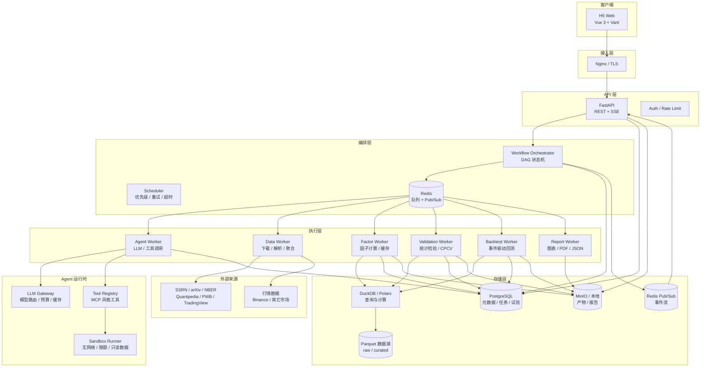

# 因子挖掘与验证 Agent 平台 — 架构设计

> 版本：v0.1  
> 日期：2026-10-17  
> 状态：设计稿，仅文档，不包含实现  
> 适用范围：因子/策略研究、自动验证、H5 任务监控

---

## 1. 项目定位

构建一个**以“可复现、抗过拟合”为核心约束**的因子研究平台：

- **Agent 自动挖掘**：从论文、预印本、策略网站中提取经济逻辑，生成可执行的因子/策略定义。
- **自动化验证**：把 PIT 审查、IC/分层、稳健性、多重检验、CPCV/DSR、最终 OOS 固化成不可绕过的流水线。
- **全流程可观测**：H5 端实时查看任务队列、阶段进度、Agent 过程输出、失败原因和最终报告。
- **试验可追溯**：每一次因子计算、参数尝试、被淘汰的候选都进入试验登记表，为 DSR/N_eff 提供真实分母。

一句话：**不是“让 Agent 帮你写因子”，而是“让 Agent 在一条有统计纪律的流水线上产出可信因子”。**

---

## 2. 设计目标与非目标

### 2.1 目标

| 目标 | 说明 |
|---|---|
| 可复现 | 任一报告都能由 `data_snapshot + code_commit + container_digest + params + seed` 重现 |
| 抗过拟合 | 试验全登记、Purge/Embargo、CPCV/WFO、BH-FDR、PBO、DSR、一次性 OOS |
| 可审计 | Agent 的每个结论都有来源引用、工具调用记录和产物哈希 |
| 可扩展 | 数据源、市场、因子算子、验证门槛、Agent 角色均可插拔 |
| 人机协同 | 关键门槛可配置人工审批；不是全自动黑箱 |
| 移动可观测 | H5 优先，任务进度/日志/结论随时可看 |

### 2.2 非目标（首期不做）

- 实盘交易、订单路由、资金托管。
- 面向多租户的 SaaS 计费体系。
- 低延迟/高频交易。
- 自动绕过付费墙或抓取禁止爬取的站点。
- 完全无人值守地“自动发现并上线”因子；最终晋升必须有人类或独立 Critic 复核。

---

## 3. 设计原则

1. **可复现优先于灵活性**：任何研究结论必须能回放到具体数据快照和代码版本。
2. **试验登记优先于统计**：没有完整试验记录的 DSR/PBO 都是自欺欺人。
3. **工作流确定、Agent 局部自治**：阶段流转由状态机控制；Agent 只负责阶段内的推理与工具调用。
4. **PIT 与 OOS 是架构约束，不是编码规范**：由数据层和隔离金库强制实施，而不是靠自觉。
5. **先便宜后昂贵**：去重、静态审计、快速 IC 先做；CPCV、蒙特卡洛、OOS 后做。
6. **单一事实来源**：PostgreSQL 记录状态与指标；对象存储记录产物；Redis 只做队列与事件分发。
7. **市场无关、配置化**：A 股截面因子与加密时序策略共用一套内核，验证阈值由 `ValidationProfile` 决定。
8. **默认不信任 LLM 生成代码**：静态检查 + 沙箱 + 负对照 + 人工复核。

---

## 4. 系统全景

---

## 5. 核心架构决策

| # | 决策 | 选择 | 理由 | 备选 |
|---|---|---|---|---|
| D1 | 工作流形态 | **确定性 DAG + Agent 步骤** | Agent 自由循环不可审计、难重试；DAG 可暂停/恢复/人工审批 | 全自主 Agent、LangGraph 自由图 |
| D2 | 因子定义 | **受限表达式 DSL 优先，Python 插件兜底** | 可静态审计、可缓存、可跨市场复用；Python 仅受控场景 | 纯 Python 代码生成 |
| D3 | 试验记录 | **Trial Registry 为一等公民** | N_eff、DSR、FDR 的真实分母；防止“只记录成功的” | 只存最终因子 |
| D4 | 计算引擎 | **Polars 向量化面板 + 事件驱动回测双引擎** | 研究要快，策略验证要真实（手续费/滑点/资金费率），两者需对账 | 只用事件驱动（慢）、只用向量化（失真） |
| D5 | 队列 | **Celery + Redis（MVP），编排器接口可替换 Temporal** | 生态成熟、部署简单；长任务与人机审批由自有状态机兜底 | Temporal / Prefect / Dagster |
| D6 | 事件推送 | **SSE + DB 事件回放** | H5 单向监控足够；断线可续传；比 WebSocket 简单 | WebSocket |
| D7 | 数据版本 | **不可变数据快照 + 双时间轴** | PIT 审查和复现的基础 | 直接读最新文件 |
| D8 | OOS 隔离 | **独立金库 + 一次性解锁令牌 + 不可变账本** | 把“只能看一次”落到架构上 | 约定/文档约束 |
| D9 | Agent 代码执行 | **无网络沙箱 + AST 白名单 + 资源限额** | LLM 生成代码不可信 | 直接在 Worker 进程执行 |
| D10 | 前端 | **Vue 3 + TypeScript + Vite + Vant 4 + ECharts** | H5 组件成熟、包体小、上手快 | React + Ant Design Mobile |
| D11 | 数据库 | **PostgreSQL（元数据）+ Parquet/DuckDB（研究数据）** | 事务与 JSONB 灵活；列存适合面板计算 | 全用 PostgreSQL、全用文件 |
| D12 | 验证阈值 | **按市场/频率配置的 ValidationProfile** | A 股与加密市场的 IC 分布不可直接套用 | 全局硬编码 |

---

## 6. 对原始设想的调整建议

原始需求已经覆盖了统计验证的主干，以下是架构上建议补充或修正的点：

1. **区分“截面因子”和“时序策略”**
   - IC、分位数、Barra/FF 正交化属于**截面股票**范式；
   - 当前仓库的数据是 Binance USDT 合约，现有 `EmaStrategy` 是**时序策略**；
   - 平台用 `scope: cross_sectional | time_series` 区分，验证 Profile 分别配置。不要强行给时序策略套 Rank IC。

2. **增加 Trial Registry（试验登记表）**
   - DSR 的 `N_eff` 和 BH-FDR 的分母必须包含**所有尝试过的参数与变体**，包括失败和被丢弃的；
   - 只记录成功因子会让多重检验校正失效。这是整个平台最重要的“诚实性”设计。

3. **“疑似未来函数直接丢弃”改为“隔离 + 证据”**
   - 自动判定会有误杀；建议标记 `quarantined` 并保留审计证据，由 Critic/人工复核后决定是否永久拒绝；
   - 同时保留“永久拒绝”的硬规则：PIT 回放测试不一致、标签使用未来数据、当前成分股回填历史等，直接阻断晋升。

4. **增加数据快照与双时间轴**
   - 每条数据记录 `event_time`、`available_at`、`ingested_at`；
   - 任何因子计算、回测、OOS 都绑定 `data_snapshot_id`，否则无法复现。

5. **增加 Agent Critic 与人工门槛**
   - Agent 读论文容易“望文生义”，需要独立 Critic 对抗审查经济逻辑、实现偏差、数据泄漏；
   - G0（数据/实现审计）、G5（群体级）、G7（OOS 解锁）建议默认人工确认。

6. **验证前先做去重与新颖性筛选**
   - LLM 可以在短时间内生成成百上千个近似因子；先做表达式哈希、语义相似度、因子值相关性去重，再进入昂贵检验，否则算力与多重检验都会被浪费。

7. **来源合规**
   - SSRN、NBER、Risk.net、JPM 等存在版权/付费墙；Papers With Backtest、Quantpedia、TradingView 有各自 ToS；
   - 平台应优先使用官方 API/RSS/导出/机构授权；只存元数据、摘要和引用，不默认全文分发；不做绕过限制的抓取。

8. **OOS 必须架构级隔离**
   - 仅靠“流程规定”无法阻止反复偷看；需要独立存储、访问令牌、一次性解锁、不可变账本和代码/环境冻结。

9. **阈值配置化并用负对照校准**
   - `Rank IC > 0.03` 是 A 股经验值；加密市场、不同频率、不同样本期的最优阈值不同；
   - 平台应内置**负对照因子**（随机因子、标签置换、未来数据污染因子）来校准“通过线”是否合理。

10. **H5 以监控为主，操作为辅**
    - 移动端适合看队列、进度、告警、审批和摘要报告；
    - 复杂的因子编辑、参数网格配置放在桌面端/CLI/API，避免 H5 交互过重。

---

## 7. 文档索引

| 文档 | 内容 |
|---|---|
| [01-system-architecture.md](01-system-architecture.md) | 分层架构、技术选型、运行时拓扑、模块边界、仓库结构 |
| [02-domain-model.md](02-domain-model.md) | 核心概念、FactorSpec DSL、状态机、数据库模型、版本与产物 |
| [03-agent-system.md](03-agent-system.md) | Agent 角色、工具目录、结构化契约、沙箱、成本与安全 |
| [04-validation-pipeline.md](04-validation-pipeline.md) | G0–G7 验证门槛、指标公式、通过标准、报告结构 |
| [05-data-platform.md](05-data-platform.md) | 数据源、PIT/双时间轴、MarketAdapter、快照、缓存、现有代码迁移 |
| [06-backend-api.md](06-backend-api.md) | REST/SSE API、队列与 Worker、事件协议、错误码、示例流程 |
| [07-frontend-h5.md](07-frontend-h5.md) | 信息架构、页面规格、组件、图表、SSE 客户端、移动端体验 |
| [08-security-reproducibility.md](08-security-reproducibility.md) | 威胁模型、沙箱、审计、OOS 金库、可复现清单、测试策略 |
| [09-roadmap.md](09-roadmap.md) | 里程碑、交付物、验收标准、风险与开放问题 |

---

## 8. 术语表

| 术语 | 英文 | 含义 |
|---|---|---|
| 研究任务 | Research Task | 一次完整的“来源 → 假设 → 因子 → 验证 → 报告”流程 |
| 流水线步骤 | Step | DAG 中的一个可执行节点，有独立状态、重试和产物 |
| 因子 | Factor | 将面板数据映射为信号值的定义，不含持仓 |
| 策略 | Strategy | 因子 + 组合构建 + 交易假设，产生目标持仓 |
| 试验 | Trial | 一次具体的因子/参数/数据快照组合的评估记录 |
| 因子族 | Family | 预先登记的、一起做多重检验的试验集合 |
| 验证配置 | ValidationProfile | 一组门槛阈值与检验参数，按市场/频率版本化 |
| 门槛 | Gate | 验证流水线中的通过/失败检查点（G0–G7） |
| 数据快照 | Data Snapshot | 不可变的数据版本，绑定 `raw + curated` 清单哈希 |
| 产物 | Artifact | 报告、图表、因子值、日志等文件，内容寻址存储 |
| 隔离样本 | Holdout | 只在最终阶段解锁一次的样本外数据 |
| 试验登记表 | Trial Registry | 所有尝试的追加式记录，用于 N_eff/DSR/FDR |
| 净化/缓冲 | Purge / Embargo | 训练与测试之间清除重叠标签、留出缓冲期，阻断信息泄露 |
| 组合净化交叉验证 | CPCV | Combinatorial Purged Cross-Validation |
| 回测过拟合概率 | PBO | Probability of Backtest Overfitting |
| 通缩夏普比 | DSR | Deflated Sharpe Ratio |
| 有效试验数 | N_eff | 经相关性折算后的独立试验数量 |

---

## 9. 待确认的关键决策

以下问题会影响实现细节，但本文档已给出默认方案，不阻塞设计评审：

| 问题 | 默认方案 | 影响 |
|---|---|---|
| 首个市场优先级 | **加密永续（沿用现有数据）** | 数据适配器、验证 Profile、Universe 规则 |
| A 股数据接入时间 | 第二阶段 | 需要 PIT 财务、成分股、行业、Barra 因子 |
| 部署形态 | 单机 Docker Compose | 若上云/多用户，队列与存储需升级 |
| LLM 供应商 | Anthropic Claude 为默认，接口抽象 | 成本、结构化输出能力、数据合规 |
| 多用户 | 首期单用户 + Token | 鉴权、任务隔离、配额 |
| 前端栈 | Vue 3 + Vant | 若不接受可换 React，API 不变 |

---

## 10. 建议的下一步

1. 评审本设计，确认第 9 节的默认方案。
2. 冻结 **FactorSpec DSL v1**、**ValidationProfile v1**、**事件协议 v1** 三个契约。
3. 按 [09-roadmap.md](09-roadmap.md) 的 M0 搭建研究内核与数据契约，先不接 Agent 和 H5。
4. 用现有 Binance 数据 + 一个已知因子跑通 G0–G4，校准负对照分布。
5. 再接入 Agent 与 H5，避免在统计内核未稳定时堆叠上层功能。
